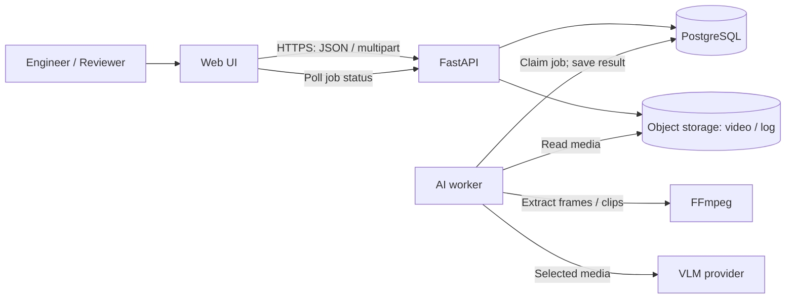

# Kiến trúc phân tích incident từ video — đề xuất để chốt

**Trạng thái:** Bản thiết kế, chưa triển khai.

**Ngày:** 22/09/2026.

**Đầu vào:** [Danh sách 11 API của nhóm](https://docs.google.com/document/d/1ZNoL5MpBbeBOGUZ5PlP0ocf1gKA2F56hZqpTALmZaos/edit?usp=sharing)

## 1. Phạm vi và các quyết định cần chốt

Mỗi incident gồm video ngắn và log tùy chọn. AI tạo bản nháp báo cáo có bằng chứng gắn mốc thời gian; Engineer kiểm tra/sửa và Reviewer phê duyệt. Chỉ báo cáo đã duyệt mới là kết luận chính thức.

| Đề xuất MVP | Lý do | Người xác nhận |
| --- | --- | --- |
| Nhận video tải lên, chưa nhận camera trực tiếp | Giữ luồng demo và đánh giá trong phạm vi rõ ràng | PO xác nhận nguồn video |
| Giới hạn ban đầu 60 giây, 100 MB, cấu hình được | Kiểm soát chi phí và thời gian VLM | PO và AI/Data thử với dữ liệu thực tế |
| Engineer sửa bản nháp; Reviewer duyệt | AI không tự ban hành kết luận | PO xác nhận vai trò |
| FastAPI + worker riêng + PostgreSQL + kho file S3-compatible | Job còn tồn tại khi tiến trình API khởi động lại | Backend/DevOps xác nhận môi trường |
| Chưa dùng vector store/RAG | Chưa có nhu cầu truy hồi tri thức trong luồng API | AI/Data đề xuất khi có nguồn và phép đo lợi ích |

**Ngoài phạm vi MVP:** camera trực tiếp, tự động phê duyệt, tìm kiếm ngữ nghĩa trên kho incident, huấn luyện model riêng. Các giả định này cần đổi nếu bài toán thực tế yêu cầu.

## 2. Sơ đồ hệ thống

FE không gọi VLM hoặc kho file trực tiếp. API kiểm tra quyền khi phát video và hỗ trợ HTTP Range để player tua tới mốc evidence. Khóa VLM chỉ nằm ở server/worker.

## 3. Thành phần

- **Web UI:** tạo incident, upload, theo dõi job, xem video/evidence, sửa/gửi/duyệt theo vai trò; không tự quyết định chuyển trạng thái hợp lệ.
- **FastAPI:** hợp đồng REST, xác thực, phân quyền, kiểm tra file, chuyển trạng thái, đọc/ghi DB và kho file; không chạy VLM trong request HTTP.
- **Worker:** lấy job từ PostgreSQL, tách frame/clip, gọi VLM, kiểm tra kết quả, ghi draft/evidence hoặc lỗi; không duyệt báo cáo.
- **PostgreSQL:** nguồn sự thật cho incident, job, report, evidence, người dùng và lịch sử duyệt; không lưu byte video.
- **Object storage:** lưu video/log bằng khóa nội bộ không đoán được; API và worker có quyền truy cập.

Repo hiện là template chatbot với route `/chat` và graph `analyze → respond`, chưa có luồng incident. Khi triển khai, thay luồng đó bằng các bước `prepare_media → analyze_segments → compose_draft → validate_evidence`. Chỉ dùng LangGraph nếu các bước cần điều phối/rẽ nhánh; pipeline tuyến tính có thể là hàm Python thông thường.

## 4. Luồng và trạng thái

1. Engineer gọi `POST /incidents` dạng `multipart/form-data` (video, log tùy chọn). API kiểm tra kích thước và loại file bằng nội dung, lưu object, tạo incident, trả `201 {id}`. Nếu một bước lỗi, dọn object mồ côi hoặc đánh dấu để dọn sau.
2. Engineer gọi `POST /incidents/{id}/analyze`. API tạo job bền trong DB, trả `202 {job_id, status}`. Một incident chỉ có một job đang hoạt động; gọi trùng trả `409` để tránh tính phí hai lần.
3. Worker claim job trong giao dịch (`FOR UPDATE SKIP LOCKED`), tách frame/clip kèm timestamp gốc, gọi VLM, chuẩn hóa kết quả. Report `DRAFT` và evidence được ghi cùng giao dịch, sau đó job thành `COMPLETED`.
4. FE polling `GET /incidents/{id}/status`; sau `COMPLETED` lấy `report` và `evidence`. Evidence có ID, `start_ms`, `end_ms`, quan sát và tham chiếu trong report. UI tua video tới đúng mốc; nhận định không có evidence phải được thể hiện là chưa xác minh.
5. Engineer `PATCH` draft với `version` để ngăn ghi đè, rồi `submit`. Reviewer `approve` hoặc `reject`; reject bắt buộc lý do và trả về `DRAFT` cho Engineer sửa.

**Analysis job:** `PENDING → PROCESSING → COMPLETED` hoặc `FAILED`. Worker timeout/restart được phát hiện qua lease; retry có giới hạn, không ghi kết quả nếu lease đã hết.

**Report:** chưa tồn tại → `DRAFT → IN_REVIEW → APPROVED`; `IN_REVIEW → DRAFT` khi reject. Engineer chỉ sửa DRAFT; Reviewer chỉ approve/reject IN_REVIEW. Hai trạng thái này tách biệt: AI xong không có nghĩa báo cáo đã duyệt.

## 5. Dữ liệu tối thiểu

- `users(id, role, identity_id)`; role là `ENGINEER` hoặc `REVIEWER`.
- `incidents(id, created_by, video_key, log_key?, duration_ms, created_at, deleted_at?)`.
- `analysis_jobs(id, incident_id, status, attempt, claimed_at, lease_until, finished_at, error_code?, model_version)`; ràng buộc tối đa một job đang hoạt động/incident.
- `reports(id, incident_id, status, version, summary, key_factors, submitted_at?, approved_at?, approved_by?, updated_at)`.
- `evidence(id, report_id, start_ms, end_ms, observation, source_type, confidence?)`; mốc video phải nằm trong độ dài clip, evidence từ log có tham chiếu log riêng thay cho mốc video.
- `review_events(report_id, actor_id, action, reason?, created_at)` để truy vết submit, approve, reject.

Lưu phiên bản model và thời điểm phân tích để giải thích nguồn gốc draft. Báo cáo và evidence ghi nguyên tử; không để report tham chiếu evidence chưa tồn tại.

## 6. Hợp đồng API

Giữ 11 endpoint trong tài liệu đầu vào, bổ sung `GET /incidents` nếu FE có màn hình danh sách/hàng chờ duyệt. Cần cơ chế đăng nhập hoặc tích hợp identity provider trước khi đưa lên internet.

| Endpoint | Hợp đồng chính |
| --- | --- |
| `POST /incidents` | Multipart video/log; `201 {id}`; `400/413/415` cho file không hợp lệ |
| `POST /incidents/{id}/analyze` | `202 {job_id, status}`; `409` nếu job trùng hoặc trạng thái không cho phép |
| `GET /incidents/{id}/status` | `{analysis_status, job_id, error_code?}`; không trộn trạng thái report |
| `GET /incidents/{id}/report` | Nội dung, trạng thái, version, evidence IDs; `404` nếu chưa có draft |
| `GET /incidents/{id}/video` | Kiểm tra quyền; hỗ trợ Range/`206 Partial Content` và Content-Type đúng |
| `GET /incidents/{id}/evidence` | ID, mốc mili giây, quan sát, loại nguồn, tham chiếu report |
| `PATCH /incidents/{id}/report` | Chỉ DRAFT; yêu cầu version, tăng version sau lưu; `409` khi xung đột |
| `POST .../report/submit` | Engineer: DRAFT → IN_REVIEW |
| `POST .../report/approve` | Reviewer: IN_REVIEW → APPROVED |
| `POST .../report/reject` | Reviewer: IN_REVIEW → DRAFT, yêu cầu reason |
| `DELETE /incidents/{id}` | Không xóa APPROVED; soft-delete metadata rồi dọn file riêng; quyền xóa cần PO chốt |

Mọi lỗi trả `{code, message}`; không lộ stack trace hoặc output VLM thô. OpenAPI triển khai sau phải cố định schema request/response, mã lỗi và phân trang trước khi FE/BE làm song song.

## 7. Bảo mật và vận hành

- HTTPS và kiểm tra quyền ở **mọi** route, kể cả video/evidence. Không dùng URL video công khai dài hạn; không gửi khóa VLM về FE.
- Chỉ gửi frame/clip cần thiết tới VLM. AI/Data kiểm tra điều khoản xử lý dữ liệu của provider và dùng video có quyền sử dụng để thử nghiệm.
- Log `request_id`, `incident_id`, `job_id`, thời lượng, retry, lỗi và mức dùng VLM; không log byte video, token hay dữ liệu nhạy cảm. Đặt timeout và theo dõi job quá hạn.
- PO chốt chính sách giữ/xóa video trước khi dùng dữ liệu thật. Hệ thống hỗ trợ soft-delete và dọn object theo lịch; chưa tự đặt thời hạn xóa.
- Local/demo: FE, API, worker, PostgreSQL và object storage chạy qua Docker Compose. Production giữ cùng ranh giới, backup DB/file, chạy worker riêng API. MVP không cần Redis hay vector DB.

## 8. Kiểm chứng trước triển khai và bàn giao

1. Clip hợp lệ: upload → xử lý → draft/evidence → click evidence tua đúng mốc → sửa → gửi duyệt → approve.
2. Clip sai loại/quá giới hạn, VLM timeout, worker restart giữa job, gọi analyze hai lần: không có hai báo cáo hoặc job kẹt mãi.
3. Engineer không approve, Reviewer không sửa draft, người không có quyền không tải video; APPROVED không bị xóa.
4. AI/Data đo độ đúng của evidence, thời gian và chi phí trên bộ clip được phép dùng; model và ngưỡng đạt sẽ chọn từ kết quả, không giả định trước.

**Xin chốt:** năm đề xuất ở mục 1, nhất là nguồn video, giới hạn clip, vai trò duyệt và môi trường triển khai. Sau đó nhóm có thể khóa OpenAPI/schema DB và chia việc FE/BE/AI/Data.
