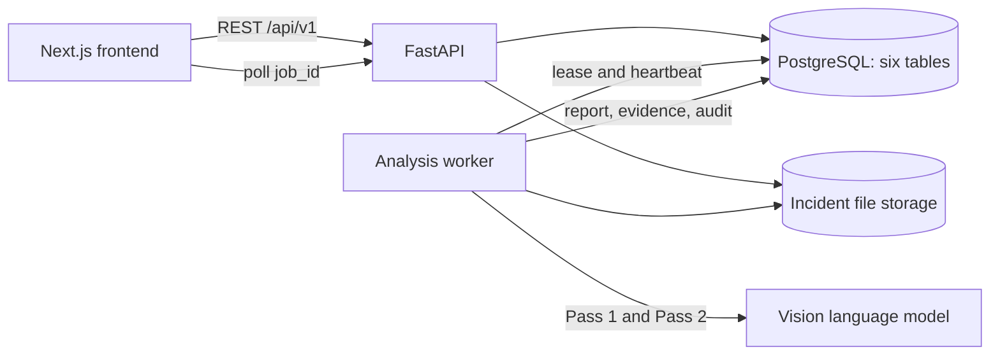

# Backend MVP architecture

Frontend source has implemented most v1.1 service changes: job polling, IDs/envelopes, versioned PATCH and evidence time conversion. Audit envelope/rendering still has gaps; browser E2E remains unverified. See [frontend integration](../../frontend/docs/api-integration.md) and the [public contract](../../api/docs/backend-contract-v1.1.md). Evidence storage paths are internal; local demo media routes serve video and evidence by `incident_id` and `evidence_id`.
