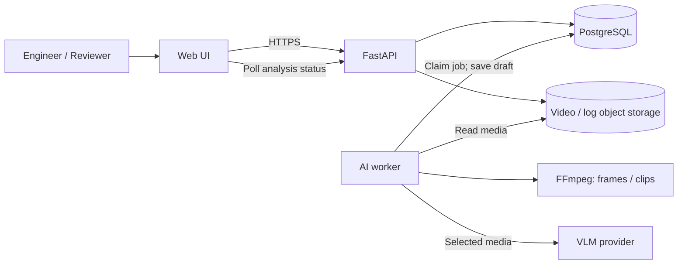

# Architecture Diagram — Incident Video Analysis MVP

> Bản đề xuất. Xem [ARCHITECTURE.md](../ARCHITECTURE.md) để biết phạm vi và quyết định cần chốt.



```mermaid
sequenceDiagram
    participant E as Engineer
    participant A as FastAPI
    participant D as PostgreSQL
    participant W as AI worker
    participant R as Reviewer
    E->>A: POST /incidents (video, optional log)
    A->>D: Save incident
    A-->>E: 201 incident_id
    E->>A: POST /incidents/{id}/analyze
    A->>D: Create PENDING job
    A-->>E: 202 job_id
    W->>D: Claim PROCESSING job
    W->>W: Extract media, call VLM, validate evidence
    W->>D: Save DRAFT + evidence; mark COMPLETED
    E->>A: GET status, report, evidence, video
    E->>A: PATCH report; POST submit
    A->>D: DRAFT to IN_REVIEW
    R->>A: POST approve or reject
    A->>D: IN_REVIEW to APPROVED or DRAFT
```

**Ranh giới:** UI hiển thị và thao tác; API giữ quyền và trạng thái; worker xử lý AI bất đồng bộ; DB lưu metadata; object storage lưu video/log. Không dùng vector store trong MVP.
