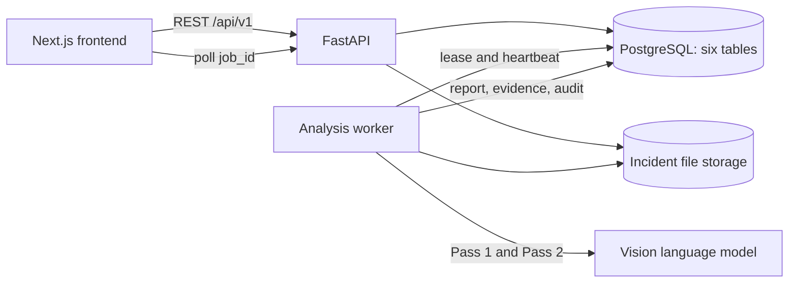

# RAV18 backend MVP architecture

The frontend currently uses an older contract. The required service-layer changes are listed in [backend-contract-v1.1.md](backend-contract-v1.1.md). The storage path returned for evidence is internal; a media-access route or signed URL remains to be specified.
