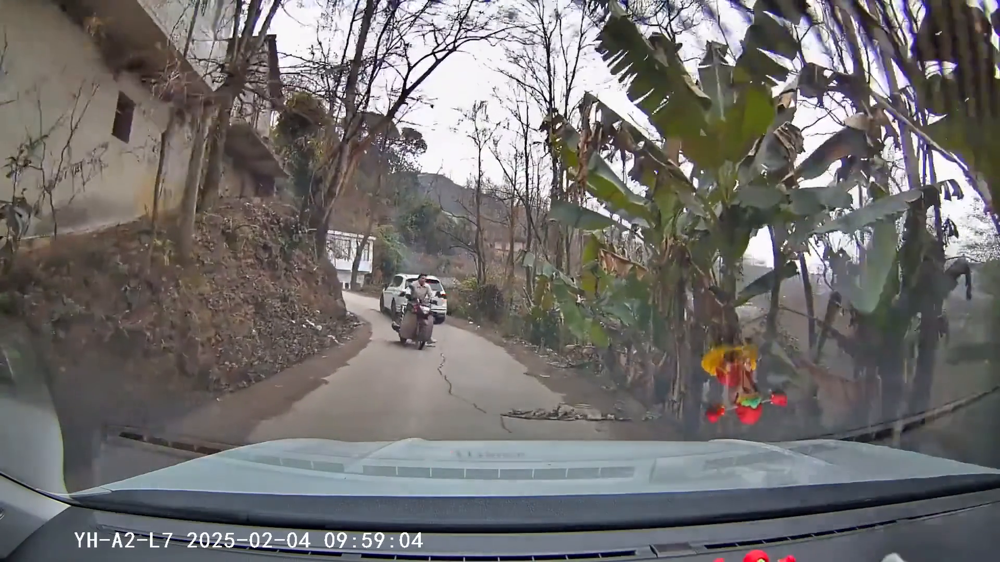
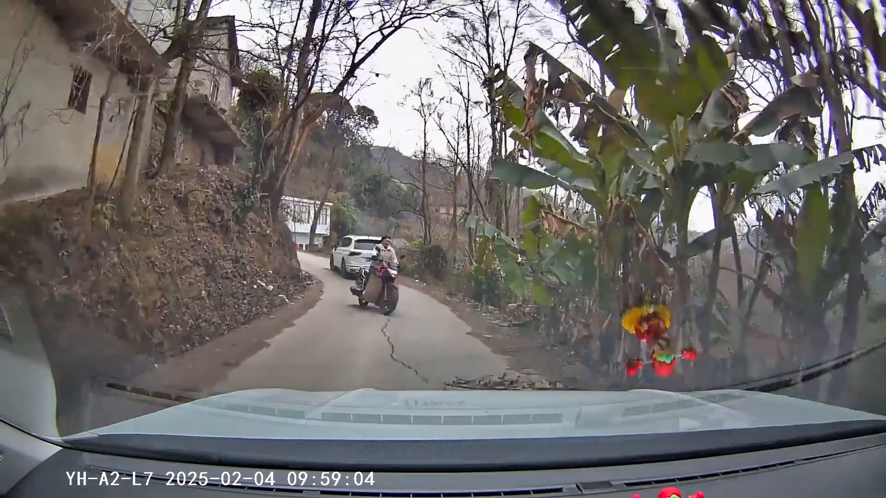
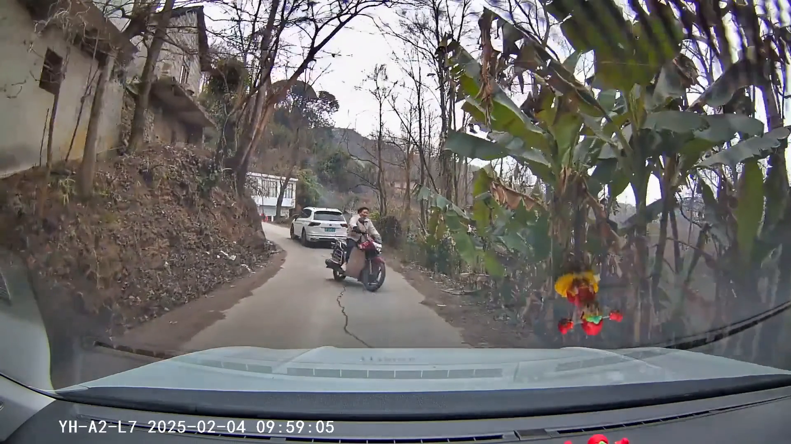
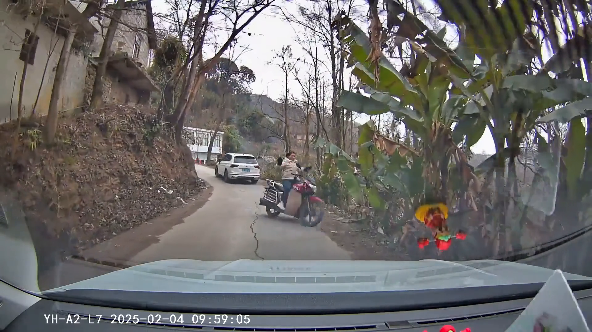
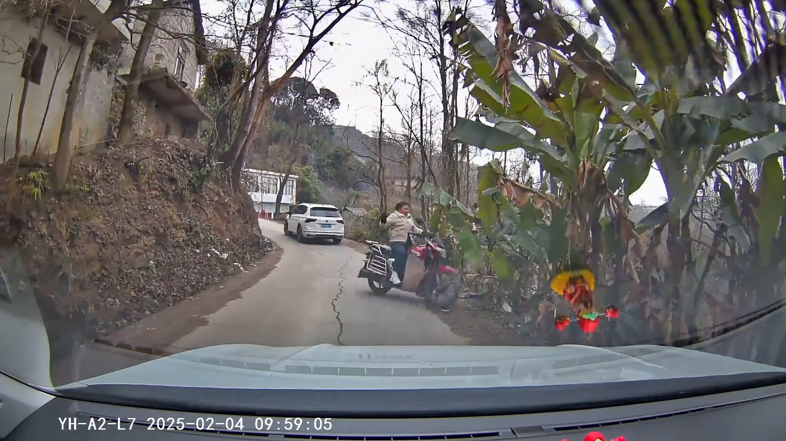
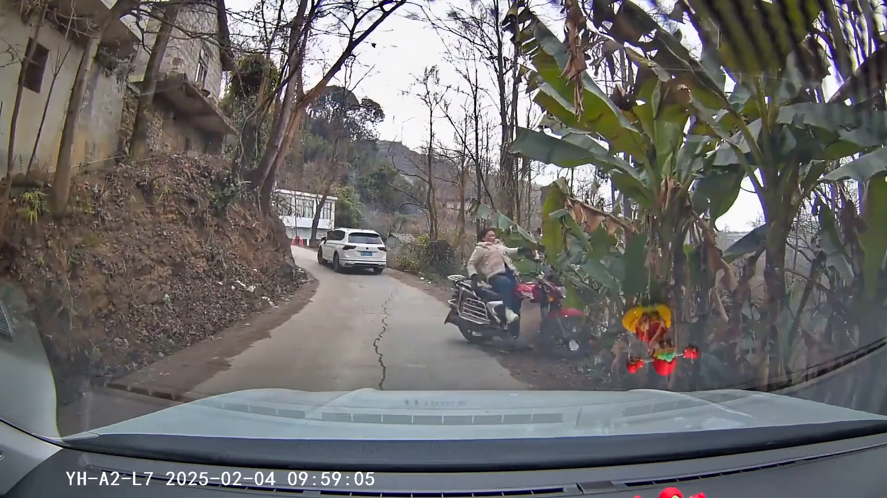
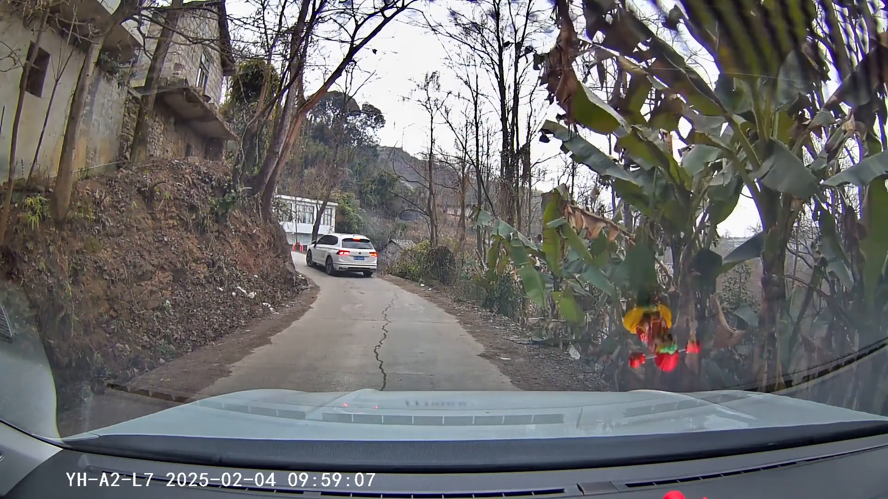

# Qwen: test độc lập 13 frame — INC-4043C786F1C4

Mỗi frame là một request riêng, có system prompt riêng. Output bên dưới là nguyên văn Qwen.
Kết quả chưa đối chiếu ground truth. Không suy ra diễn biến liên tục từ ảnh đơn.

## 8.30 giây

Timestamp thực tế: 8.300000 giây.

[System prompt](frame_008_30.system.txt) · [Request](frame_008_30.request.json) · [Raw response](frame_008_30.response.json)

1. Tổng quan: Ảnh chụp từ trong một chiếc xe đang di chuyển trên một con đường nhỏ, hai bên là cây cối và một bức tường đá. Trên đường có một người đang đi bộ, mặc áo vàng và quần đỏ, phía trước có một chiếc xe màu trắng đang di chuyển.

2. Danh sách đối tượng và vị trí:
   - Người: 1 người, mặc áo vàng và quần đỏ, đang đi bộ trên đường, ở giữa và phía trước của xe đang quay lại.
   - Xe: 1 chiếc xe màu trắng, đang di chuyển trên đường, ở phía trước và bên trái của người đi bộ.
   - Cây cối: Nhiều cây cối ở hai bên đường, đặc biệt là bên phải.
   - Bức tường đá: Bức tường đá ở bên trái của đường.

3. Chi tiết bất thường nhìn thấy: Người đi bộ đang đi vào đường, có thể gây nguy hiểm cho xe đang di chuyển.

4. Điểm chưa chắc chắn: Không có bằng chứng cụ thể về việc có va chạm hoặc va chạm tiềm ẩn giữa người đi bộ và xe.

## 9.30 giây

Timestamp thực tế: 9.300000 giây.

[System prompt](frame_009_30.system.txt) · [Request](frame_009_30.request.json) · [Raw response](frame_009_30.response.json)

1. Tổng quan: Ảnh chụp từ trong xe, hướng nhìn ra phía trước trên một con đường nhỏ, hai bên là cây cối và một ngôi nhà. Thời gian ghi hình là 09:59:04 ngày 04/02/2025.

2. Danh sách đối tượng và vị trí:
   - Một người đang đi xe máy, mặc áo màu xám, ngồi phía trước xe máy.
   - Một chiếc xe màu trắng đang di chuyển phía trước trên đường.
   - Một ngôi nhà nhỏ bên trái đường, gần với cây cối.
   - Một số cây cối và cây phong lá rụng ở hai bên đường.
   - Một số dây điện treo trên cây ở bên phải đường.

3. Chi tiết bất thường nhìn thấy: 
   - Có một số vật thể màu đỏ và vàng treo trên cửa sổ bên phải của xe đang ghi hình, có thể là đồ trang trí hoặc đồ chơi.
   - Hình ảnh có một số vết mờ, có thể là do chất lượng hình ảnh hoặc do hiệu ứng ánh sáng.

4. Điểm chưa chắc chắn: 
   - Không thể xác định rõ ràng màu sắc và chi tiết của người đi xe máy do khoảng cách và chất lượng hình ảnh.
   - Không thể xác định rõ ràng mục đích của những vật thể màu đỏ và vàng treo trên cửa sổ.

## 9.50 giây

Timestamp thực tế: 9.500000 giây.

[System prompt](frame_009_50.system.txt) · [Request](frame_009_50.request.json) · [Raw response](frame_009_50.response.json)

1. Tổng quan: Ảnh chụp từ trong một chiếc xe hơi, hướng nhìn ra phía trước trên một con đường nhỏ. Xe đang di chuyển trên đường, và phía trước có một người lái xe máy và một chiếc xe ô tô đang di chuyển theo hướng ngược lại.

2. Danh sách đối tượng và vị trí:
   - Người lái xe máy: Một người mặc áo trắng, ngồi trên xe máy, đang di chuyển về phía trước.
   - Xe ô tô: Một chiếc xe màu trắng đang di chuyển ngược lại, gần bên người lái xe máy.
   - Xe hơi: Chiếc xe này đang được quay từ phía sau, nhìn thấy phần đầu xe.
   - Cây cối: Nhiều cây cối xung quanh đường, chủ yếu là cây lá rộng.
   - Công trình: Có một công trình xây dựng ở phía trái đường, gần với người lái xe máy.

3. Chi tiết bất thường nhìn thấy: Không có dấu hiệu của tai nạn hoặc va chạm trong hình ảnh này. Mọi thứ đều đang di chuyển bình thường.

4. Điểm chưa chắc chắn: Không có thông tin cụ thể về tốc độ của các phương tiện hoặc sự tương tác giữa chúng.

## 9.70 giây

Timestamp thực tế: 9.700000 giây.

[System prompt](frame_009_70.system.txt) · [Request](frame_009_70.request.json) · [Raw response](frame_009_70.response.json)

1. Tổng quan: Ảnh chụp từ trong một chiếc xe, hướng nhìn ra phía trước trên một con đường nhỏ. Xe phía trước đang di chuyển trên đường, và phía trước có một người lái xe máy và một người đi bộ.

2. Danh sách đối tượng và vị trí:
   - Người lái xe máy: Một người đang ngồi trên xe máy, mặc áo màu trắng và quần màu tối. Người này đang di chuyển trên đường.
   - Người đi bộ: Một người đang đi bộ trên đường, mặc áo màu đỏ và quần màu xanh. Người này đang di chuyển phía trước và bên phải của người lái xe máy.
   - Xe máy: Một chiếc xe máy màu đen đang di chuyển trên đường.
   - Xe ô tô: Một chiếc xe ô tô màu trắng đang di chuyển phía trước và bên trái của người lái xe máy.
   - Xe phía trước: Một chiếc xe màu trắng đang di chuyển phía trước và bên trái của người lái xe máy.
   - Đường: Một con đường nhỏ với vạch kẻ đường.
   - Cây cối: Có cây cối và bụi cây ở hai bên đường.
   - Công trình: Có một công trình cũ ở bên trái đường.

3. Chi tiết bất thường nhìn thấy: Không có dấu hiệu của tai nạn hoặc va chạm trong hình ảnh này. Mọi người và phương tiện đều đang di chuyển bình thường.

4. Điểm chưa chắc chắn: Không có thông tin cụ thể về tốc độ của các phương tiện hoặc chuyển động của chúng. Hình ảnh tĩnh nên không thể xác định được chuyển động chính xác.

## 9.90 giây

Timestamp thực tế: 9.900000 giây.

[System prompt](frame_009_90.system.txt) · [Request](frame_009_90.request.json) · [Raw response](frame_009_90.response.json)

1. Tổng quan: Ảnh chụp từ trong một chiếc xe, hướng nhìn ra phía trước trên một con đường nhỏ. Có một người đang đứng bên cạnh một chiếc xe máy, và phía trước có một chiếc xe hơi đang di chuyển.

2. Danh sách đối tượng và vị trí:
   - Người: Một người mặc áo màu trắng, đứng bên cạnh một chiếc xe máy màu đỏ.
   - Xe máy: Một chiếc xe máy màu đỏ, có người đứng bên cạnh.
   - Xe hơi: Một chiếc xe hơi màu trắng đang di chuyển trên đường.
   - Xe: Một chiếc xe màu trắng đang di chuyển trên đường.
   - Cây cối: Nhiều cây cối xung quanh đường, chủ yếu là cây lá rộng.
   - Công trình: Một công trình xây dựng có vẻ cũ kỹ bên trái đường.

3. Chi tiết bất thường nhìn thấy: Không có dấu hiệu của tai nạn hoặc va chạm trong hình ảnh. Người đứng bên cạnh xe máy có vẻ đang gesticulating hoặc đang nói chuyện.

4. Điểm chưa chắc chắn: Không có thông tin cụ thể về tốc độ của các phương tiện, cũng không có thông tin về việc có ai đó đang cố gắng vượt qua hoặc có va chạm nào xảy ra.

## 10.00 giây

Timestamp thực tế: 10.000000 giây.

[System prompt](frame_010_00.system.txt) · [Request](frame_010_00.request.json) · [Raw response](frame_010_00.response.json)

1. Tổng quan: Ảnh chụp từ trong một chiếc xe, hướng nhìn ra phía trước trên một con đường nhỏ. Có một người phụ nữ đang đi xe máy từ bên phải sang bên trái đường, phía trước có một chiếc xe hơi đang di chuyển từ xa.

2. Danh sách đối tượng và vị trí:
   - Người phụ nữ: Đang đi xe máy, mặc áo khoác màu trắng, quần jeans, ngồi phía trước xe máy.
   - Xe máy: Đang di chuyển từ phải sang trái, có một số đồ đạc được đặt trên yên xe.
   - Xe hơi: Đang di chuyển từ xa, hướng về phía người phụ nữ.
   - Xe hơi phía trước: Phần đầu xe đang xuất hiện ở phía xa bên trái của hình ảnh.
   - Nhà cửa: Có một ngôi nhà nhỏ bên trái đường, phía sau người phụ nữ.
   - Cây cối: Nhiều cây cối xung quanh đường, đặc biệt là cây có lá lớn ở bên phải hình ảnh.
   - Đường: Con đường nhỏ, có vạch kẻ đường.

3. Chi tiết bất thường nhìn thấy: Không có dấu hiệu của tai nạn hoặc va chạm trong hình ảnh. Người phụ nữ đang đi xe máy từ phải sang trái, và xe hơi đang di chuyển từ xa.

4. Điểm chưa chắc chắn: Không có thông tin cụ thể về tốc độ của xe hoặc người phụ nữ, cũng không có thông tin về việc có bất kỳ sự cố nào xảy ra trong hình ảnh.

## 10.10 giây

Timestamp thực tế: 10.100000 giây.

[System prompt](frame_010_10.system.txt) · [Request](frame_010_10.request.json) · [Raw response](frame_010_10.response.json)

1. **Tổng quan**: Ảnh chụp từ trong một chiếc xe hơi, hướng nhìn ra phía trước trên một con đường nhỏ. Có một người đang ngồi trên một chiếc xe máy ở bên phải đường, và phía trước có một chiếc xe hơi đang di chuyển.

2. **Danh sách đối tượng và vị trí**:
   - **Người**: Một người đang ngồi trên một chiếc xe máy, mặc áo trắng và quần xanh, ngồi ở bên phải đường.
   - **Xe máy**: Một chiếc xe máy màu đỏ, người ngồi trên xe.
   - **Xe hơi**: Một chiếc xe hơi màu trắng đang di chuyển phía trước.
   - **Cây cối**: Nhiều cây cối và cây phong lá rộng ở hai bên đường.
   - **Đường**: Con đường nhỏ, có vạch kẻ đường.
   - **Hình ảnh trên kính xe**: Có một hình ảnh nhỏ, màu vàng, dán trên kính xe.

3. **Chi tiết bất thường nhìn thấy**: Không có dấu hiệu của tai nạn hoặc va chạm. Xe hơi đang di chuyển bình thường, và người trên xe máy cũng không có biểu hiện bất thường.

4. **Điểm chưa chắc chắn**: Không có thông tin cụ thể về tốc độ của xe hoặc chuyển động của các đối tượng khác. Hình ảnh trên kính xe có thể là một đồ trang trí hoặc nhãn hiệu, nhưng không thể xác định rõ từ ảnh này.

## 10.20 giây

Timestamp thực tế: 10.200000 giây.

[System prompt](frame_010_20.system.txt) · [Request](frame_010_20.request.json) · [Raw response](frame_010_20.response.json)

1. Tổng quan: Ảnh chụp từ trong một chiếc xe, hướng nhìn ra phía trước trên một con đường nhỏ. Có một người và một chiếc xe máy dừng lại ở bên phải đường, gần một ngôi nhà và một số cây cối.

2. Danh sách đối tượng và vị trí:
   - Người: Một người mặc áo khoác màu nâu, đang đứng bên cạnh chiếc xe máy.
   - Xe máy: Một chiếc xe máy màu đỏ, dừng lại ở bên phải đường.
   - Xe ô tô: Một chiếc xe ô tô màu trắng đang di chuyển từ xa, hướng về phía người và xe máy.
   - Nhà: Một ngôi nhà nhỏ ở bên trái đường.
   - Cây cối: Một số cây cối lớn ở bên phải đường, gần người và xe máy.

3. Chi tiết bất thường nhìn thấy: Người đứng bên cạnh xe máy có vẻ như đang cố gắng làm gì đó hoặc đang chờ đợi. Không có dấu hiệu của tai nạn hoặc va chạm trong hình ảnh này.

4. Điểm chưa chắc chắn: Không có thông tin cụ thể về nguyên nhân tại sao người này đứng ở đó hoặc tại sao xe máy dừng lại.

## 10.50 giây

Timestamp thực tế: 10.500000 giây.

[System prompt](frame_010_50.system.txt) · [Request](frame_010_50.request.json) · [Raw response](frame_010_50.response.json)

1. Tổng quan: Ảnh chụp từ trong một chiếc xe, hướng nhìn ra phía trước trên một con đường nhỏ. Có một chiếc xe màu trắng đang di chuyển từ xa về phía trước. Xung quanh là cây cối và một số công trình.

2. Danh sách đối tượng và vị trí:
   - Chiếc xe màu trắng: Ở giữa đường, đang di chuyển từ xa về phía trước.
   - Xe máy: Ở bên phải, có người ngồi trên xe máy.
   - Người: Trên xe máy, mặc áo khoác màu nâu.
   - Cây cối: Phía bên phải và phía trước, có cây cối và một cây có lá lớn.
   - Công trình: Phía trái, có một công trình cũ, có vẻ như là một nhà hoặc một phần của một tòa nhà.

3. Chi tiết bất thường nhìn thấy: Không có dấu hiệu của tai nạn hoặc sự cố nào trong hình ảnh này.

4. Điểm chưa chắc chắn: Không có thông tin cụ thể về tốc độ của các phương tiện, không thể xác định chính xác vị trí của các đối tượng trong không gian thực.

## 10.90 giây

Timestamp thực tế: 10.900000 giây.

[System prompt](frame_010_90.system.txt) · [Request](frame_010_90.request.json) · [Raw response](frame_010_90.response.json)

1. Tổng quan: Ảnh chụp từ trong xe, hướng nhìn ra phía trước trên một con đường nhỏ, có một chiếc xe đang di chuyển từ xa đến gần. Xung quanh là cây cối và một ngôi nhà ở bên trái.

2. Danh sách đối tượng và vị trí:
   - Chiếc xe màu trắng đang di chuyển từ xa đến gần, nằm ở giữa đường.
   - Một ngôi nhà cũ ở bên trái, phía sau con đường.
   - Một số cây cối và cây phong lá rụng ở hai bên đường.
   - Một chiếc xe máy có đèn đỏ và vàng ở bên phải, gần với cây cối.

3. Chi tiết bất thường nhìn thấy: 
   - Chiếc xe máy ở bên phải có đèn sáng, có thể là do đèn pha hoặc đèn hậu đang sáng.
   - Không có biển báo giao thông hoặc vạch đường rõ ràng trong hình ảnh.

4. Điểm chưa chắc chắn:
   - Không rõ chiếc xe máy ở bên phải có đang di chuyển hay dừng lại.
   - Không có thông tin về tốc độ của các phương tiện trong hình ảnh.

## 11.50 giây

Timestamp thực tế: 11.500000 giây.

[System prompt](frame_011_50.system.txt) · [Request](frame_011_50.request.json) · [Raw response](frame_011_50.response.json)

1. Tổng quan: Ảnh chụp từ trong một chiếc xe, hướng nhìn ra phía trước trên một con đường nhỏ. Xe phía trước đang di chuyển trên đường, và có một chiếc xe màu trắng đang di chuyển từ xa về phía trước.

2. Danh sách đối tượng và vị trí:
   - Chiếc xe màu trắng: Ở giữa đường, phía trước của chiếc xe đang quay lại.
   - Xe phía trước: Ở phía trước của hình ảnh, nhìn ra phía trước.
   - Cây cối: Ở hai bên đường, cây cối mọc dọc theo đường.
   - Tường: Ở bên trái của đường, có một bức tường cao.
   - Biển báo: Không thấy biển báo nào trong hình ảnh.
   - Vạch đường: Không thấy vạch đường rõ ràng trong hình ảnh.

3. Chi tiết bất thường nhìn thấy: Không có bất kỳ chi tiết bất thường nào được ghi nhận trong hình ảnh.

4. Điểm chưa chắc chắn: Không có thông tin nào trong hình ảnh cho phép xác định chính xác về tốc độ, chuyển động, va chạm hoặc nguyên nhân từ một ảnh tĩnh.

## 12.50 giây

Timestamp thực tế: 12.500000 giây.

[System prompt](frame_012_50.system.txt) · [Request](frame_012_50.request.json) · [Raw response](frame_012_50.response.json)

1. Tổng quan: Ảnh chụp từ trong một chiếc xe, hướng nhìn ra phía trước trên một con đường nhỏ. Xe phía trước đang di chuyển trên đường, và có một chiếc xe màu trắng đang di chuyển từ xa về phía trước.

2. Danh sách đối tượng và vị trí:
   - Xe phía trước: Một chiếc xe màu trắng đang di chuyển từ xa về phía trước.
   - Xe trong hình: Chiếc xe đang ghi hình, nhìn ra phía trước.
   - Đường: Con đường nhỏ, có vạch giữa.
   - Nhà: Một ngôi nhà nằm bên trái đường.
   - Cây cối: Nhiều cây cối và cây phong lá rụng nằm hai bên đường.
   - Biển báo: Không thấy biển báo nào trong hình.
   - Công trình: Một công trình xây dựng nằm bên trái đường.
   - Vật trên đường: Không thấy vật gì trên đường.

3. Chi tiết bất thường nhìn thấy: Không có bất kỳ chi tiết bất thường nào được ghi nhận trong hình.

4. Điểm chưa chắc chắn: Không có thông tin nào để xác định tốc độ của xe hoặc có va chạm nào xảy ra.

## 13.50 giây

Timestamp thực tế: 13.500000 giây.

[System prompt](frame_013_50.system.txt) · [Request](frame_013_50.request.json) · [Raw response](frame_013_50.response.json)

1. Tổng quan: Ảnh chụp từ trong một chiếc xe, hướng nhìn ra phía trước trên một con đường nhỏ. Xe phía trước đang di chuyển trên đường.

2. Danh sách đối tượng và vị trí:
   - Xe phía trước: Một chiếc xe màu trắng đang di chuyển trên đường, nằm ở giữa đường.
   - Xe trong hình: Chiếc xe đang ghi hình, có thể là chiếc xe đang quay video, nằm ở phía trước và dưới cùng của hình ảnh.
   - Nhà: Một ngôi nhà nằm bên trái đường, gần với xe phía trước.
   - Cây cối: Nhiều cây cối và cây phong lá rộng nằm ở hai bên đường.
   - Đường: Một con đường nhỏ, có vẻ như là một con đường nông thôn hoặc khu vực ngoại ô.

3. Chi tiết bất thường nhìn thấy: Không có dấu hiệu của tai nạn hoặc sự cố nào trong hình ảnh. Đường và xe đều đang hoạt động bình thường.

4. Điểm chưa chắc chắn: Không có thông tin cụ thể về tốc độ của xe hoặc hướng di chuyển của chúng. Hình ảnh chỉ thể hiện một khoảnh khắc tĩnh và không thể xác định được chuyển động hoặc tốc độ.

## Kiểm tra thực thi

- 13/13 request hoàn tất, done_reason=stop; timestamp chính xác, không lệch mốc yêu cầu.
- Model qwen2.5vl:7b; RTX 2080 Ti; Ollama báo 100% GPU trước và sau test.
- Ảnh PNG 1920×1080; temperature=0, seed=42; từng request chỉ chứa một ảnh.
- Tổng thời gian gọi inference: 155.11 giây; chưa tính trích ảnh và truyền file.
- Đã kiểm tra SHA256 13 ảnh và đối chiếu output.txt với raw response và results.json.

## Lưu ý khi đọc output

Output giữ nguyên, chưa được xác nhận là nhận diện đúng. Đối chiếu trực quan frame 8,30 giây cho thấy Qwen có dấu hiệu nhầm đồ trang trí đỏ/vàng trên kính thành người đi bộ. Một số phản hồi vẫn suy đoán chuyển động dù system prompt yêu cầu chỉ quan sát ảnh tĩnh. Đây là hạn chế của kết quả model; không chỉnh sửa hoặc lọc output.
