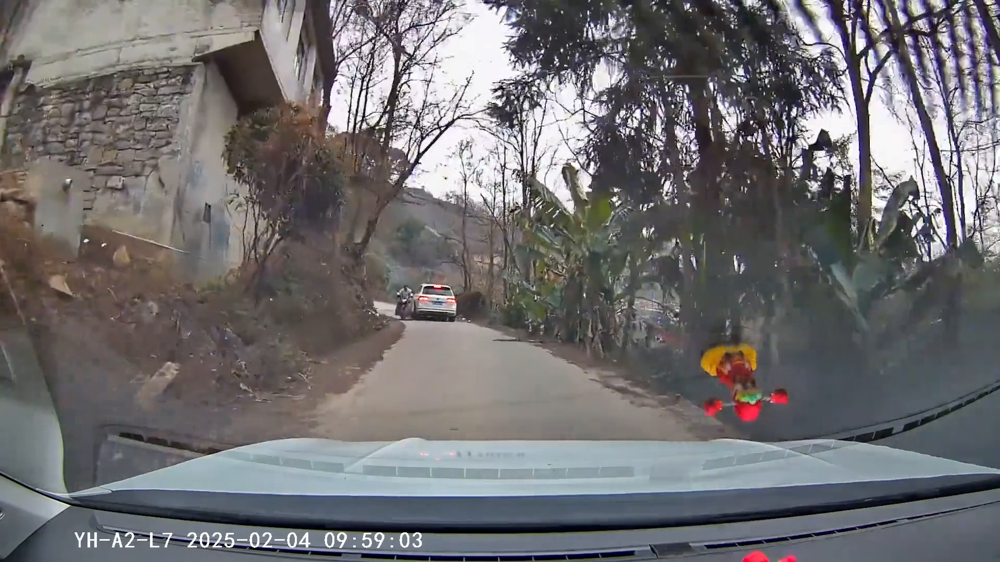
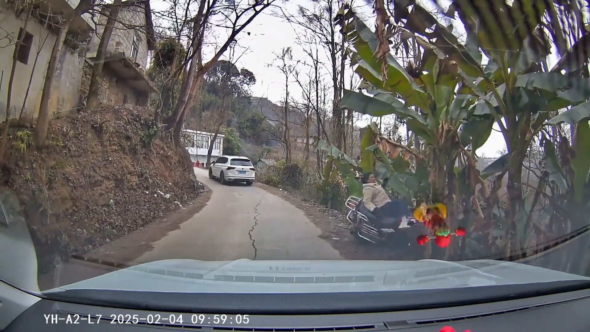
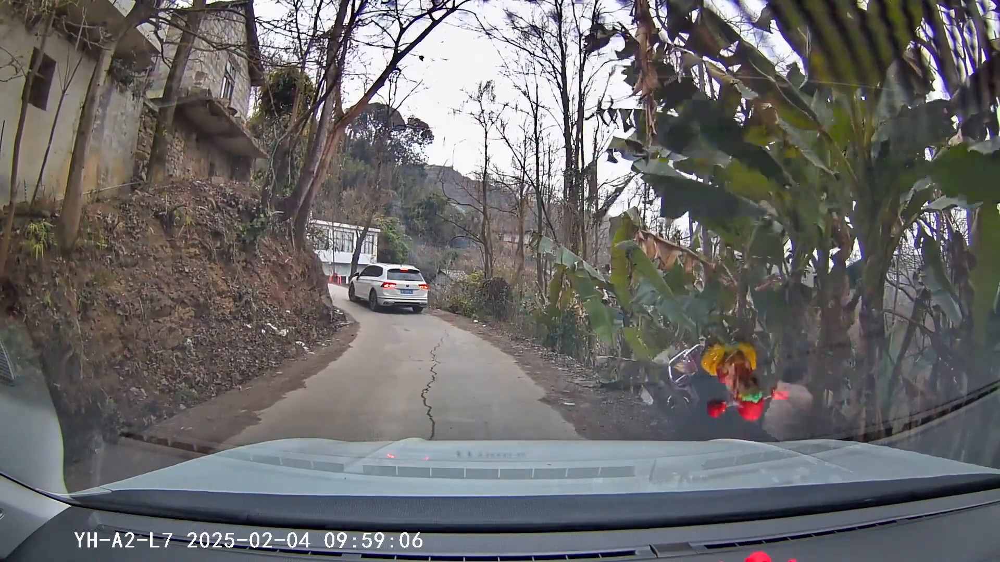
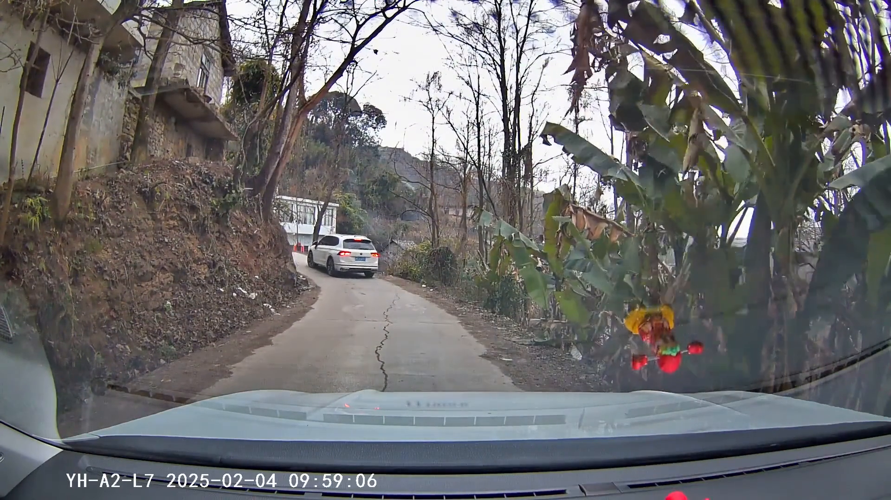
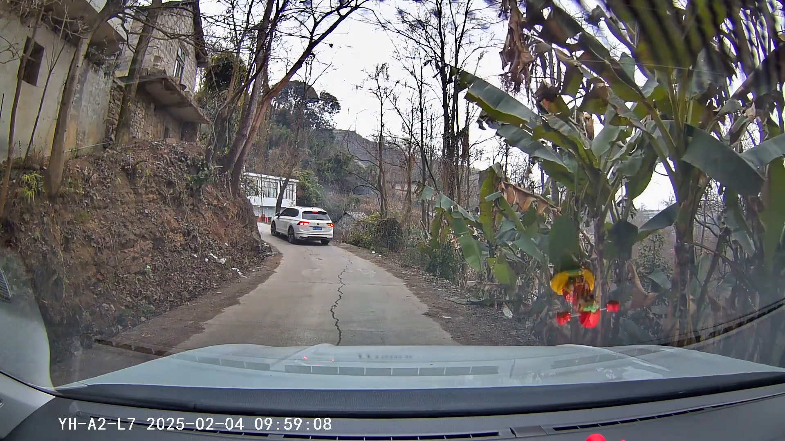

# Qwen Stage 1 prompt mới: test độc lập 13 frame — INC-4043C786F1C4

Mỗi frame là một request riêng, có system prompt riêng. Output bên dưới là nguyên văn Qwen.
Kết quả chưa đối chiếu ground truth. Không suy ra diễn biến liên tục từ ảnh đơn.

## Kiểm tra và nhận xét

Dùng nguyên văn Stage 1, test mỗi ảnh độc lập; chưa chạy Stage 2. Không ép format=json để giữ phản hồi tự nhiên theo prompt.

- 13/13 request hoàn tất với done_reason=stop. SHA256 cả 13 ảnh trùng lượt trước, timestamp khớp yêu cầu.
- Cùng qwen2.5vl:7b, temperature=0, seed=42. Tăng num_predict từ 1600 lên 4096 để chứa JSON dài hơn.
- 0/13 là JSON thuần; tất cả bọc trong Markdown. Sau khi bỏ dấu bao, 13/13 parse được. Raw output giữ nguyên; .parsed.json chỉ bỏ dấu bao.
- 8,30 giây: vẫn nhầm đồ trang trí đỏ/vàng thành người/xe máy, đồng thời mô tả người vừa đứng vừa ngồi.
- Một số attached_to dùng tên category thay vì local_id; nhiều output vẫn khẳng định chuyển động từ ảnh đơn.
- Chưa có benchmark ground truth; chưa thể kết luận prompt mới cải thiện độ chính xác.

## 8.30 giây

Timestamp thực tế: 8.300000 giây.



[System prompt](frame_008_30.system.txt) · [Request](frame_008_30.request.json) · [Raw response](frame_008_30.response.json)

```json
{
  "frame_observation": {
    "scene": "Đường đi qua khu vực có cây cối và tường đá, xe đang di chuyển trên đường.",
    "objects": [
      {
        "local_id": "obj_01",
        "category": "person",
        "subtype": "standing",
        "appearance": "đỏ, mặc áo vàng, đang đứng",
        "position": "phải; gần",
        "road_relation": "trên lòng đường",
        "visible_pose": "standing",
        "attached_to": null,
        "occlusion": "none",
        "visual_evidence": "người mặc áo vàng và quần đỏ đứng trên đường",
        "certainty": "clear"
      },
      {
        "local_id": "obj_02",
        "category": "motorcycle",
        "subtype": "motorcycle",
        "appearance": "đỏ, có người ngồi",
        "position": "phải; gần",
        "road_relation": "trên lòng đường",
        "visible_pose": "seated_on_vehicle",
        "attached_to": "obj_01",
        "occlusion": "none",
        "visual_evidence": "người mặc áo vàng và quần đỏ ngồi trên xe máy màu đỏ",
        "certainty": "clear"
      },
      {
        "local_id": "obj_03",
        "category": "car",
        "subtype": "car",
        "appearance": "trắng, đang di chuyển",
        "position": "giữa; xa",
        "road_relation": "trên lòng đường",
        "visible_pose": "standing",
        "attached_to": null,
        "occlusion": "none",
        "visual_evidence": "xe màu trắng đang di chuyển phía trước",
        "certainty": "clear"
      }
    ],
    "road_features": ["đường đi qua khu vực có cây cối và tường đá"],
    "visible_interactions": ["không có"],
    "unusual_visual_cues": ["không có"],
    "unknowns": ["không có"]
  }
}
```

## 9.30 giây

Timestamp thực tế: 9.300000 giây.


[System prompt](frame_009_30.system.txt) · [Request](frame_009_30.request.json) · [Raw response](frame_009_30.response.json)

```json
{
  "frame_observation": {
    "scene": "Đường nhỏ với hai bên là cây cối và nhà cửa, xe đang di chuyển trên đường.",
    "objects": [
      {
        "local_id": "obj_01",
        "category": "person",
        "subtype": "standing",
        "appearance": "người mặc áo màu vàng và quần đỏ, đang đứng trên xe máy",
        "position": "phải; gần",
        "road_relation": "trên lòng đường",
        "visible_pose": "standing",
        "attached_to": "motorcycle",
        "occlusion": "none",
        "visual_evidence": "người mặc áo vàng và quần đỏ đứng trên xe máy",
        "certainty": "clear"
      },
      {
        "local_id": "obj_02",
        "category": "person",
        "subtype": "seated_on_vehicle",
        "appearance": "người mặc áo trắng, đang ngồi trên xe máy",
        "position": "giữa; gần",
        "road_relation": "trên lòng đường",
        "visible_pose": "seated_on_vehicle",
        "attached_to": "motorcycle",
        "occlusion": "none",
        "visual_evidence": "người mặc áo trắng ngồi trên xe máy",
        "certainty": "clear"
      },
      {
        "local_id": "obj_03",
        "category": "motorcycle",
        "subtype": "loại cụ thể không rõ",
        "appearance": "xe máy màu trắng",
        "position": "giữa; gần",
        "road_relation": "trên lòng đường",
        "visible_pose": "seated_on_vehicle",
        "attached_to": "motorcycle",
        "occlusion": "none",
        "visual_evidence": "xe máy màu trắng có người ngồi",
        "certainty": "clear"
      },
      {
        "local_id": "obj_04",
        "category": "car",
        "subtype": "loại cụ thể không rõ",
        "appearance": "xe màu trắng",
        "position": "trái; xa",
        "road_relation": "trên lòng đường",
        "visible_pose": "standing",
        "attached_to": null,
        "occlusion": "none",
        "visual_evidence": "xe màu trắng đang di chuyển trên đường",
        "certainty": "clear"
      }
    ],
    "road_features": ["đường nhỏ, hai bên là cây cối và nhà cửa"],
    "visible_interactions": ["không có giao tiếp không gian"],
    "unusual_visual_cues": ["không có dấu hiệu bất thường"],
    "unknowns": ["không có chi tiết không đủ chứng cứ"]
  }
}
```

## 9.50 giây

Timestamp thực tế: 9.500000 giây.


[System prompt](frame_009_50.system.txt) · [Request](frame_009_50.request.json) · [Raw response](frame_009_50.response.json)

```json
{
  "frame_observation": {
    "scene": "Đường nhỏ với hai bên là cây cối và một ngôi nhà ở phía trước. Xe đang di chuyển trên đường.",
    "objects": [
      {
        "local_id": "obj_01",
        "category": "person",
        "subtype": "standing",
        "appearance": "người mặc áo trắng, đội mũ bảo hiểm",
        "position": "giữa",
        "road_relation": "trên lòng đường",
        "visible_pose": "standing",
        "attached_to": null,
        "occlusion": "none",
        "visual_evidence": "người đứng trên xe máy, mặc áo trắng và đội mũ bảo hiểm",
        "certainty": "clear"
      },
      {
        "local_id": "obj_02",
        "category": "motorcycle",
        "subtype": "xe máy",
        "appearance": "xe máy màu đen",
        "position": "giữa",
        "road_relation": "trên lòng đường",
        "visible_pose": "standing",
        "attached_to": "obj_01",
        "occlusion": "none",
        "visual_evidence": "xe máy màu đen, người đứng trên xe",
        "certainty": "clear"
      },
      {
        "local_id": "obj_03",
        "category": "car",
        "subtype": "xe ô tô",
        "appearance": "xe ô tô màu trắng",
        "position": "giữa",
        "road_relation": "trên lòng đường",
        "visible_pose": "standing",
        "attached_to": null,
        "occlusion": "none",
        "visual_evidence": "xe ô tô màu trắng phía trước",
        "certainty": "clear"
      }
    ],
    "road_features": ["đường nhỏ, hai bên là cây cối"],
    "visible_interactions": ["không có tương tác rõ ràng"],
    "unusual_visual_cues": ["không có dấu hiệu bất thường"],
    "unknowns": ["không có chi tiết không đủ chứng cứ"]
  }
}
```

## 9.70 giây

Timestamp thực tế: 9.700000 giây.


[System prompt](frame_009_70.system.txt) · [Request](frame_009_70.request.json) · [Raw response](frame_009_70.response.json)

```json
{
  "frame_observation": {
    "scene": "Đường nhỏ với hai bên là cây cối và nhà cửa, xe đang di chuyển trên đường.",
    "objects": [
      {
        "local_id": "obj_01",
        "category": "motorcycle",
        "subtype": "xe máy",
        "appearance": "màu đen",
        "position": "giữa",
        "road_relation": "trên lòng đường",
        "visible_pose": "ngồi",
        "attached_to": null,
        "occlusion": "none",
        "visual_evidence": "xe máy màu đen, người ngồi trên xe",
        "certainty": "clear"
      },
      {
        "local_id": "obj_02",
        "category": "car",
        "subtype": "xe ô tô",
        "appearance": "màu trắng",
        "position": "giữa",
        "road_relation": "trên lòng đường",
        "visible_pose": "đi",
        "attached_to": null,
        "occlusion": "none",
        "visual_evidence": "xe ô tô màu trắng phía trước",
        "certainty": "clear"
      },
      {
        "local_id": "obj_03",
        "category": "person",
        "subtype": "người ngồi trên xe máy",
        "appearance": "màu da, mặc áo màu nâu",
        "position": "giữa",
        "road_relation": "trên lòng đường",
        "visible_pose": "ngồi",
        "attached_to": "obj_01",
        "occlusion": "none",
        "visual_evidence": "người ngồi trên xe máy màu đen",
        "certainty": "clear"
      }
    ],
    "road_features": ["đường nhỏ, hai bên là cây cối và nhà cửa"],
    "visible_interactions": ["xe máy và xe ô tô đang di chuyển trên đường"],
    "unusual_visual_cues": ["không có dấu hiệu bất thường"],
    "unknowns": ["không có chi tiết không đủ chứng cứ"]
  }
}
```

## 9.90 giây

Timestamp thực tế: 9.900000 giây.


[System prompt](frame_009_90.system.txt) · [Request](frame_009_90.request.json) · [Raw response](frame_009_90.response.json)

```json
{
  "frame_observation": {
    "scene": "Đường nhỏ với hai bên là cây cối và một ngôi nhà ở phía trái. Xe đang di chuyển trên đường, phía trước có một người lái xe máy và một người đi bộ phía sau.",
    "objects": [
      {
        "local_id": "obj_01",
        "category": "person",
        "subtype": "standing",
        "appearance": "người mặc áo trắng, đội mũ bảo hiểm",
        "position": "giữa",
        "road_relation": "trên lòng đường",
        "visible_pose": "standing",
        "attached_to": null,
        "occlusion": "none",
        "visual_evidence": "người đứng yên trên xe máy",
        "certainty": "clear"
      },
      {
        "local_id": "obj_02",
        "category": "person",
        "subtype": "walking_pose",
        "appearance": "người mặc áo đỏ, đội mũ vàng",
        "position": "phải",
        "road_relation": "trên lòng đường",
        "visible_pose": "walking_pose",
        "attached_to": null,
        "occlusion": "none",
        "visual_evidence": "người đi bộ phía sau xe máy",
        "certainty": "clear"
      },
      {
        "local_id": "obj_03",
        "category": "motorcycle",
        "subtype": "loại cụ thể không rõ",
        "appearance": "xe máy màu đỏ",
        "position": "giữa",
        "road_relation": "trên lòng đường",
        "visible_pose": "standing",
        "attached_to": null,
        "occlusion": "none",
        "visual_evidence": "xe máy có người lái đứng yên",
        "certainty": "clear"
      }
    ],
    "road_features": ["đường nhỏ, hai bên là cây cối"],
    "visible_interactions": ["người lái xe máy đứng yên, người đi bộ đi phía sau"],
    "unusual_visual_cues": ["không có dấu hiệu bất thường"],
    "unknowns": ["không có chi tiết không đủ chứng cứ"]
  }
}
```

## 10.00 giây

Timestamp thực tế: 10.000000 giây.


[System prompt](frame_010_00.system.txt) · [Request](frame_010_00.request.json) · [Raw response](frame_010_00.response.json)

```json
{
  "frame_observation": {
    "scene": "Đường nhỏ với hai bên là cây cối và nhà cửa, xe đang di chuyển trên đường.",
    "objects": [
      {
        "local_id": "obj_01",
        "category": "person",
        "subtype": "standing",
        "appearance": "người mặc áo trắng, quần xanh",
        "position": "giữa",
        "road_relation": "trên lòng đường",
        "visible_pose": "tư thế đứng",
        "attached_to": null,
        "occlusion": "none",
        "visual_evidence": "người đứng trên xe máy",
        "certainty": "clear"
      },
      {
        "local_id": "obj_02",
        "category": "motorcycle",
        "subtype": "xe máy",
        "appearance": "xe máy màu đen",
        "position": "giữa",
        "road_relation": "trên lòng đường",
        "visible_pose": "tư thế đứng",
        "attached_to": null,
        "occlusion": "none",
        "visual_evidence": "xe máy có người đứng trên",
        "certainty": "clear"
      },
      {
        "local_id": "obj_03",
        "category": "car",
        "subtype": "xe ô tô",
        "appearance": "xe ô tô màu trắng",
        "position": "trái",
        "road_relation": "trên lòng đường",
        "visible_pose": "tư thế di chuyển",
        "attached_to": null,
        "occlusion": "none",
        "visual_evidence": "xe ô tô đang di chuyển phía trước",
        "certainty": "clear"
      }
    ],
    "road_features": ["đường nhỏ, hai bên là cây cối và nhà cửa"],
    "visible_interactions": ["người đứng trên xe máy và xe ô tô di chuyển"],
    "unusual_visual_cues": ["không có dấu hiệu bất thường"],
    "unknowns": ["không có chi tiết không đủ chứng cứ"]
  }
}
```

## 10.10 giây

Timestamp thực tế: 10.100000 giây.


[System prompt](frame_010_10.system.txt) · [Request](frame_010_10.request.json) · [Raw response](frame_010_10.response.json)

```json
{
  "frame_observation": {
    "scene": "Đường nhỏ với hai bên là cây cối và một ngôi nhà ở phía trái. Xe đang di chuyển trên đường, nhìn thấy một người và một chiếc xe máy phía trước.",
    "objects": [
      {
        "local_id": "obj_01",
        "category": "person",
        "subtype": "standing",
        "appearance": "người mặc áo trắng, quần xanh",
        "position": "giữa",
        "road_relation": "trên lòng đường",
        "visible_pose": "standing",
        "attached_to": null,
        "occlusion": "none",
        "visual_evidence": "người đứng trên xe máy, nhìn rõ",
        "certainty": "clear"
      },
      {
        "local_id": "obj_02",
        "category": "motorcycle",
        "subtype": "motorcycle",
        "appearance": "xe máy màu đỏ",
        "position": "giữa",
        "road_relation": "trên lòng đường",
        "visible_pose": "standing",
        "attached_to": null,
        "occlusion": "none",
        "visual_evidence": "chiếc xe máy màu đỏ, người đứng trên",
        "certainty": "clear"
      },
      {
        "local_id": "obj_03",
        "category": "car",
        "subtype": "car",
        "appearance": "xe màu trắng",
        "position": "giữa",
        "road_relation": "trên lòng đường",
        "visible_pose": "standing",
        "attached_to": null,
        "occlusion": "none",
        "visual_evidence": "xe màu trắng phía trước",
        "certainty": "clear"
      }
    ],
    "road_features": ["đường nhỏ, hai bên là cây cối và một ngôi nhà"],
    "visible_interactions": ["người đứng trên xe máy, xe đang di chuyển"],
    "unusual_visual_cues": ["không có dấu hiệu bất thường"],
    "unknowns": ["không có chi tiết không đủ chứng cứ"]
  }
}
```

## 10.20 giây

Timestamp thực tế: 10.200000 giây.


[System prompt](frame_010_20.system.txt) · [Request](frame_010_20.request.json) · [Raw response](frame_010_20.response.json)

```json
{
  "frame_observation": {
    "scene": "Đường nhỏ với hai bên là cây cối và nhà cửa, xe đang di chuyển trên đường.",
    "objects": [
      {
        "local_id": "obj_01",
        "category": "person",
        "subtype": "standing",
        "appearance": "người mặc áo màu nâu, quần jeans",
        "position": "giữa",
        "road_relation": "trên lòng đường",
        "visible_pose": "tư thế đứng",
        "attached_to": null,
        "occlusion": "none",
        "visual_evidence": "người đứng bên cạnh xe máy",
        "certainty": "clear"
      },
      {
        "local_id": "obj_02",
        "category": "motorcycle",
        "subtype": "xe máy",
        "appearance": "xe máy màu đen",
        "position": "giữa",
        "road_relation": "trên lòng đường",
        "visible_pose": "xe máy dừng lại",
        "attached_to": null,
        "occlusion": "none",
        "visual_evidence": "xe máy có người đứng bên cạnh",
        "certainty": "clear"
      },
      {
        "local_id": "obj_03",
        "category": "car",
        "subtype": "xe hơi",
        "appearance": "xe hơi màu trắng",
        "position": "trái",
        "road_relation": "trên lòng đường",
        "visible_pose": "xe hơi đang di chuyển",
        "attached_to": null,
        "occlusion": "none",
        "visual_evidence": "xe hơi ở phía trước",
        "certainty": "clear"
      }
    ],
    "road_features": ["đường nhỏ, hai bên là cây cối và nhà cửa"],
    "visible_interactions": ["người đứng bên cạnh xe máy"],
    "unusual_visual_cues": ["không có dấu hiệu bất thường"],
    "unknowns": ["không có chi tiết không đủ chứng cứ"]
  }
}
```

## 10.50 giây

Timestamp thực tế: 10.500000 giây.



[System prompt](frame_010_50.system.txt) · [Request](frame_010_50.request.json) · [Raw response](frame_010_50.response.json)

```json
{
  "frame_observation": {
    "scene": "Đường nhỏ với hai bên là cây cối và nhà cửa, xe đang di chuyển trên đường.",
    "objects": [
      {
        "local_id": "obj_01",
        "category": "person",
        "subtype": "standing",
        "appearance": "người mặc áo khoác màu nâu, ngồi trên xe máy",
        "position": "phải",
        "road_relation": "trên lòng đường",
        "visible_pose": "ngồi",
        "attached_to": "motorcycle",
        "occlusion": "none",
        "visual_evidence": "người ngồi trên xe máy, rõ ràng",
        "certainty": "clear"
      },
      {
        "local_id": "obj_02",
        "category": "motorcycle",
        "subtype": "xe máy",
        "appearance": "xe máy màu đen",
        "position": "phải",
        "road_relation": "trên lòng đường",
        "visible_pose": "ngồi",
        "attached_to": "person",
        "occlusion": "none",
        "visual_evidence": "xe máy có người ngồi trên",
        "certainty": "clear"
      },
      {
        "local_id": "obj_03",
        "category": "car",
        "subtype": "xe ô tô",
        "appearance": "xe ô tô màu trắng",
        "position": "giữa",
        "road_relation": "trên lòng đường",
        "visible_pose": "chạy",
        "attached_to": null,
        "occlusion": "none",
        "visual_evidence": "xe ô tô đang di chuyển phía trước",
        "certainty": "clear"
      }
    ],
    "road_features": ["đường nhỏ, hai bên là cây cối và nhà cửa"],
    "visible_interactions": ["không có tương tác rõ ràng"],
    "unusual_visual_cues": ["không có dấu hiệu bất thường"],
    "unknowns": ["không có chi tiết không đủ chứng cứ"]
  }
}
```

## 10.90 giây

Timestamp thực tế: 10.900000 giây.



[System prompt](frame_010_90.system.txt) · [Request](frame_010_90.request.json) · [Raw response](frame_010_90.response.json)

```json
{
  "frame_observation": {
    "scene": "Đường nhỏ với hai bên là cây cối và nhà cửa, xe đang di chuyển trên đường.",
    "objects": [
      {
        "local_id": "obj_01",
        "category": "car",
        "subtype": "xe hơi",
        "appearance": "trắng",
        "position": "giữa",
        "road_relation": "trên lòng đường",
        "visible_pose": "stationary",
        "attached_to": null,
        "occlusion": "none",
        "visual_evidence": "xe màu trắng đang di chuyển phía trước",
        "certainty": "clear"
      },
      {
        "local_id": "obj_02",
        "category": "motorcycle",
        "subtype": "xe máy",
        "appearance": "đỏ",
        "position": "phải",
        "road_relation": "trên lòng đường",
        "visible_pose": "standing",
        "attached_to": null,
        "occlusion": "none",
        "visual_evidence": "xe máy màu đỏ đang di chuyển",
        "certainty": "clear"
      }
    ],
    "road_features": ["đường nhỏ, hai bên là cây cối và nhà cửa"],
    "visible_interactions": ["xe hơi di chuyển phía trước, xe máy di chuyển"],
    "unusual_visual_cues": ["không có dấu hiệu bất thường"],
    "unknowns": ["không có chi tiết không đủ chứng cứ"]
  }
}
```

## 11.50 giây

Timestamp thực tế: 11.500000 giây.



[System prompt](frame_011_50.system.txt) · [Request](frame_011_50.request.json) · [Raw response](frame_011_50.response.json)

```json
{
  "frame_observation": {
    "scene": "Đường nhỏ với hai bên là cây cối và nhà cửa, xe đang di chuyển trên đường.",
    "objects": [
      {
        "local_id": "obj_01",
        "category": "car",
        "subtype": "xe màu trắng",
        "appearance": "xe màu trắng",
        "position": "giữa",
        "road_relation": "trên lòng đường",
        "visible_pose": "đi",
        "attached_to": null,
        "occlusion": "none",
        "visual_evidence": "xe màu trắng đang di chuyển phía trước",
        "certainty": "clear"
      },
      {
        "local_id": "obj_02",
        "category": "person",
        "subtype": "standing",
        "appearance": "người mặc áo vàng, quần đen, đang đứng trên xe máy",
        "position": "phải",
        "road_relation": "trên lòng đường",
        "visible_pose": "standing",
        "attached_to": "motorcycle",
        "occlusion": "none",
        "visual_evidence": "người mặc áo vàng, quần đen, đang đứng trên xe máy",
        "certainty": "clear"
      }
    ],
    "road_features": ["đường nhỏ, hai bên là cây cối và nhà cửa"],
    "visible_interactions": ["không có tương tác rõ ràng"],
    "unusual_visual_cues": ["không có dấu hiệu bất thường"],
    "unknowns": ["không có chi tiết không đủ chứng cứ"]
  }
}
```

## 12.50 giây

Timestamp thực tế: 12.500000 giây.


[System prompt](frame_012_50.system.txt) · [Request](frame_012_50.request.json) · [Raw response](frame_012_50.response.json)

```json
{
  "frame_observation": {
    "scene": "Đường nhỏ với hai bên là cây cối và nhà cửa, xe đang di chuyển trên đường.",
    "objects": [
      {
        "local_id": "obj_01",
        "category": "car",
        "subtype": "xe màu trắng",
        "appearance": "màu trắng",
        "position": "giữa",
        "road_relation": "trên lòng đường",
        "visible_pose": "đi",
        "attached_to": null,
        "occlusion": "none",
        "visual_evidence": "xe màu trắng đang di chuyển phía trước",
        "certainty": "clear"
      }
    ],
    "road_features": ["đường nhỏ, hai bên là cây cối và nhà cửa"],
    "visible_interactions": ["không có tương tác rõ ràng"],
    "unusual_visual_cues": ["không có dấu hiệu bất thường"],
    "unknowns": ["không có chi tiết không đủ chứng cứ"]
  }
}
```

## 13.50 giây

Timestamp thực tế: 13.500000 giây.



[System prompt](frame_013_50.system.txt) · [Request](frame_013_50.request.json) · [Raw response](frame_013_50.response.json)

```json
{
  "frame_observation": {
    "scene": "Đường nhỏ với hai bên là cây cối và nhà cửa, xe đang di chuyển trên đường.",
    "objects": [
      {
        "local_id": "obj_01",
        "category": "car",
        "subtype": "xe màu trắng",
        "appearance": "màu trắng",
        "position": "giữa",
        "road_relation": "trên lòng đường",
        "visible_pose": "đi",
        "attached_to": null,
        "occlusion": "none",
        "visual_evidence": "xe màu trắng đang di chuyển phía trước",
        "certainty": "clear"
      }
    ],
    "road_features": ["đường nhỏ, hai bên là cây cối và nhà cửa"],
    "visible_interactions": ["không có tương tác rõ ràng"],
    "unusual_visual_cues": ["không có dấu hiệu bất thường"],
    "unknowns": ["không có chi tiết không đủ chứng cứ"]
  }
}
```
