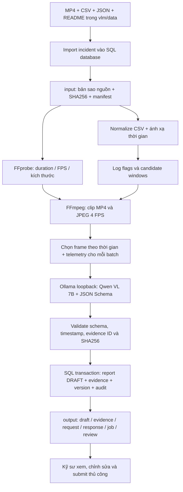

# Phân tích video incident bằng Ollama và Qwen VL 7B local

## 1. Mục tiêu và phạm vi

Backend đọc MP4 và log tại `vlm/data`, trích xuất evidence, gọi Qwen local,
kiểm tra cấu trúc và evidence của kết quả, lưu database dưới trạng thái `DRAFT`.
Kỹ sư xem video, log và draft trước khi sửa hoặc submit để review.
FE và các HTTP contract hiện có được giữ nguyên. Luồng này chạy native trên Windows,
không cần Docker hay dịch vụ inference ngoài máy.

Model là **`qwen2.5vl:7b`**, có khả năng đọc ảnh. `qwen2.5:7b` chỉ xử lý văn bản,
không phù hợp để nhìn frame video. Ollama dùng quantization của tag 7B; metadata có thể
ghi tổng số tham số 8.3B gồm thành phần vision. Đây vẫn là tag Qwen VL 7B đã chọn.

Nguồn API: [Ollama Qwen2.5VL](https://ollama.com/library/qwen2.5vl:7b),
[OpenAI compatibility](https://docs.ollama.com/api/openai-compatibility),
[Structured outputs](https://docs.ollama.com/capabilities/structured-outputs).

## 2. Luồng input, model, output và database



**MP4 không được gửi trực tiếp tới endpoint chat.** FFmpeg đọc MP4 và trích JPEG.
Mỗi request chứa ảnh base64, timestamp của ảnh, telemetry đã đồng bộ, các log flag,
evidence ID và JSON Schema. Dữ liệu vẫn nằm trong máy.

CSV là telemetry đầu vào. Các JSON sidecar, `incidents.json`, `*.expected.json` và
README được lưu nguyên trạng để kỹ sư tra cứu. Không đưa nhãn kịch bản, đáp án
hoặc nội dung README vào prompt; tránh dùng đáp án để tạo kết quả giả.

## 3. Điều kiện chạy

- Windows PowerShell, Python có các package trong `requirements.txt`.
- `ffmpeg` và `ffprobe` trên PATH.
- Ollama đã cài, hoặc dùng bản portable trong `backend/data/runtime/ollama`.
- Máy đủ RAM cho Qwen VL 7B. CPU có thể chạy nhưng chậm; cần đo latency thực tế.
- Chạy mọi lệnh dưới thư mục root `C:\Su\T076\P-076`.

```powershell
Set-Location C:\Su\T076\P-076
python -m pip install -r requirements.txt
ffmpeg -version
ffprobe -version
```

Không cần cài SDK Ollama hay OpenAI cho luồng này: backend dùng `httpx` hiện có.

## 4. Khởi động Ollama và tải Qwen

Nếu Ollama nằm trên PATH:

```powershell
$env:OLLAMA_HOST = '127.0.0.1:11434'
$env:OLLAMA_CONTEXT_LENGTH = '32768'
$env:OLLAMA_NO_CLOUD = '1'
ollama serve
```

Giữ terminal này chạy. Mở terminal thứ hai để tải và kiểm tra:

```powershell
ollama pull qwen2.5vl:7b
ollama list
Invoke-RestMethod http://127.0.0.1:11434/api/tags
Invoke-RestMethod -Method Post -Uri http://127.0.0.1:11434/api/show `
  -ContentType 'application/json' -Body '{"model":"qwen2.5vl:7b"}'
```

Trường `capabilities` phải chứa `vision`. Backend cũng kiểm tra điều này và dừng
nếu Ollama không sẵn sàng hoặc model không hỗ trợ vision.

Với bản portable đã tải trong workspace, thay `ollama` bằng:

```powershell
& .\backend\data\runtime\ollama\ollama.exe serve
& .\backend\data\runtime\ollama\ollama.exe pull qwen2.5vl:7b
```

Hai lệnh trên vẫn chạy ở hai terminal khác nhau. Nếu đã có server ở cổng 11434,
dùng server đó; không mở thêm server cùng cổng. Model tải về
`C:\Users\Lenovo\.ollama\models`; việc tải model cần Internet, inference dùng loopback.

Có thể chạy Ollama ẩn với log để dễ kiểm tra:

```powershell
$env:OLLAMA_HOST = '127.0.0.1:11434'
$env:OLLAMA_CONTEXT_LENGTH = '32768'
$env:OLLAMA_NO_CLOUD = '1'
New-Item -ItemType Directory -Path .\logs\runtime -Force | Out-Null
Start-Process -FilePath (Resolve-Path .\backend\data\runtime\ollama\ollama.exe) `
  -ArgumentList 'serve' -WindowStyle Hidden `
  -RedirectStandardOutput .\logs\runtime\ollama.stdout.log `
  -RedirectStandardError .\logs\runtime\ollama.stderr.log
```

## 5. Cấu hình backend và database native

Tham khảo `.env.ollama.example`. Nếu chưa có `.env`, copy file mẫu:

```powershell
Copy-Item .env.ollama.example .env
```

Nếu đã có `.env`, cập nhật từng biến cần thiết, giữ các cấu hình khác.
Profile local dùng SQLite qua SQLAlchemy và Alembic hiện có. Database không phải
legacy JSON store. Có thể thay `DATABASE_URL` bằng PostgreSQL native đang chạy.

Các biến chính:

| Biến | Giá trị profile local | Ý nghĩa |
|---|---|---|
| `DATABASE_URL` | `sqlite:///./backend/data/incidentlens-ollama.db` | SQL database persistent |
| `INCIDENT_STORAGE_DIR` | `./backend/data/incidents` | Input/output và evidence |
| `QWEN_RUNTIME` | `ollama` | Chọn Ollama, không khởi động llama-server |
| `QWEN_ENDPOINT` | `http://127.0.0.1:11434/v1/chat/completions` | Endpoint chỉ loopback |
| `QWEN_OLLAMA_MODEL` | `qwen2.5vl:7b` | Model vision local |
| `QWEN_PROMPT_PATH` | `./backend/data/promt.txt` | Prompt Stage A/B V3 đang sử dụng |
| `QWEN_ARTIFACT_SUBDIR` | `output` | Thư mục artifact mỗi incident |
| `QWEN_TIMEOUT_S` | `1800` | Timeout từng request, giây |
| `QWEN_SAMPLING_FPS` | `4` | FPS trích ảnh candidate |
| `QWEN_BATCH_FRAMES` | `1` | Chỉ áp dụng adapter legacy; pipeline V3 gửi 4 frame có thứ tự trong mỗi request |
| `QWEN_INFERENCE_FRAME_LIMIT` | `4` | 4 ảnh mỗi candidate, luôn có ảnh gần critical nhất |
| `QWEN_CANDIDATE_MIN_ACCELERATION` | `8` | Ưu tiên candidate có flag trị tuyệt đối gia tốc >= 8 m/s² hoặc collision |

Ảnh evidence gửi Ollama được giới hạn chiều rộng 640 px, giữ tỷ lệ hình.
MP4 gốc vẫn được lưu đầy đủ. Giới hạn inference 4 ảnh khác với 4 FPS extraction:
toàn bộ ảnh trích được lưu, nhưng model chỉ nhìn ảnh đã chọn. Khoảng trống được ghi
trong `unknowns`; không tuyên bố đã phân tích mọi frame video.
Để phân tích mọi ảnh trích được, bỏ dòng `QWEN_INFERENCE_FRAME_LIMIT` khỏi `.env`
và bỏ biến môi trường tương ứng nếu có. Thời gian CPU sẽ tăng đáng kể.
Việc chọn ảnh trải theo cửa sổ và luôn giữ ảnh gần mốc critical; không bỏ mốc
phanh chỉ vì làm tròn chỉ số khi giới hạn inference. Profile CPU vẫn phát hiện
và lưu mọi log candidate, nhưng chỉ gửi candidate có flag
gia tốc mạnh hoặc va chạm sang model. Candidate còn lại được ghi `UNANALYZED` và
`unknowns`, không kết luận an toàn. Bỏ `QWEN_CANDIDATE_MIN_ACCELERATION` để Qwen
phân tích tất cả log candidate; nếu muốn kiểm tra cả video, cần tăng visual sampling
và đánh giá recall riêng. Threshold này không dùng nhãn JSON/expected của bộ dữ liệu.

Khởi tạo schema trước khi import:

```powershell
$env:DATABASE_URL = 'sqlite:///./backend/data/incidentlens-ollama.db'
python -m alembic upgrade head
```

Phải đặt biến môi trường ở lệnh migration vì `alembic.ini` có URL PostgreSQL mặc định,
được ưu tiên trước Settings `.env` trong Alembic env hiện có.

Input manifest và các JSON nguồn được lưu thêm trong `Incident.raw_incident_data`,
với vai trò `SOURCE_METADATA_ONLY_NOT_MODEL_EVIDENCE`. Video/CSV/JPEG nằm trên
filesystem; database giữ URI, hash, metadata, report, version, evidence và audit.

## 6. Chạy phân tích bộ dữ liệu hiện tại

```powershell
New-Item -ItemType Directory -Path logs/runtime -Force | Out-Null
python -m backend.analyze_local_dataset `
  --input vlm/data `
  --log-offset-s 58.458 `
  --offset-source 'vlm/data/README.md frame mapping t(n)=-58.458+n/24; CARLA dataset' `
  *> logs/runtime/ollama-dataset-run.log
```

Offset được truyền rõ ràng, không suy từ tên file. Với CSV này:

```text
video_seconds = sec_from_incident + 58.458
```

Dòng đầu CSV là `-58.458s`. Tài liệu nguồn ghi mốc này tương ứng đầu video.
Hai anchor xây dựng từ offset xác nhận quan hệ affine trong pipeline, nhưng không
phải phép đo độc lập độ đồng bộ cảm biến. Kỹ sư vẫn cần kiểm tra mapping bằng video.
Đoạn CSV sau duration video được lưu nguyên trạng, không đưa vào candidate ngoài clip.

**Mỗi lần chạy tạo incident/job mới.** Không chạy lại chỉ để xem trạng thái.
Xem log, database hoặc endpoint GET. Nếu thất bại, giữ artifact cũ để điều tra.
Lệnh chỉ dừng khi worker hoàn thành hoặc trả trạng thái lỗi; không tự approve draft.

## 7. Cấu trúc thư mục và file

```text
vlm/data/                                  # Nguồn ban đầu, không sửa
backend/data/incidentlens-ollama.db         # SQL database native
logs/runtime/ollama-dataset-run.log         # Log chạy import/worker
backend/data/runtime/ollama/
  ollama.exe
logs/runtime/                             # stdout/stderr/PID dịch vụ
  ollama.stdout.log
  ollama.stderr.log
logs/qwen/outputs.txt                      # journal toàn cục giữ lịch sử
backend/data/incidents/INC-<id>/
  input/
    <tên-gốc>.mp4
    <tên-gốc>.csv
    <tên-gốc>.json
    <tên-gốc>.expected.json
    incidents.json
    README.md
    manifest.json                          # Vai trò file, SHA256, size, clock
  source/                                  # Artifact ingestion ban đầu
    video.mp4
    telemetry.csv
  output/
    runtime.json                           # Model digest, endpoint, sampling
    normalized-telemetry.json               # Raw columns + normalized clock
    candidates.json                         # Mọi candidate/flag, trạng thái UNANALYZED
    job.json                               # Job ID, trạng thái, lỗi nếu có
    requests/
      <request-id>.request.json             # Payload thật, gồm base64 ảnh
      <request-id>.attempt-1.response.json   # Raw JSON model, HTTP envelope hoặc error
    outputs.txt                            # JSONL append-only từng request
    local-evidence/<bundle-hash>/
      clip.mp4
      frame-0000.jpg
      ...
      manifest.json                        # Evidence ID, hash, timestamp
      telemetry.json                       # Signals được phép gửi model
    local-analysis.json                    # Mọi batch V2 + provenance + coverage
    draft.json                             # Report đọc lại từ database
    draft-v2.json                          # Nội dung đầy đủ, summary/unknowns cả khi âm tính
    model-metadata.json                    # Offset, provider, manifest, uncertainty
    evidence.json                          # Evidence đọc lại từ database
    review.json                            # DRAFT, người duyệt null, bước tiếp
```

`draft.json`, `evidence.json`, `review.json` chỉ được xuất sau khi SQL transaction
hoàn thành thành công. Khi lỗi, xem `job.json`, raw response và log worker.
`input/manifest.json` phân biệt video, telemetry và reference_only.
`outputs.txt` theo từng run không ghi đè lịch sử file `logs/qwen/outputs.txt` cũ.
`model_frame_count` đếm ảnh đã gửi; `validated_model_frame_count` đếm ảnh thuộc
lô có output hợp lệ. Lô vi phạm schema được lưu với `INVALID_MODEL_OUTPUT`, để
`unknowns` và tiếp tục lô độc lập. Nếu mọi lô đều lỗi, job thất bại; không tạo báo
cáo "không phát hiện". Lỗi evidence hoặc window vẫn khiến job thất bại.

## 8. Backend gọi Qwen local thế nào

Các hàm chạy thật:

1. `backend.services.incidents.create_incident`: validate MP4/CSV, probe, tạo Incident.
2. `backend.services.jobs.create_job`: tạo job persistent và audit.
3. `backend.worker.run_once`: claim lease, giữ heartbeat khi inference đang chặn.
4. `backend.services.qwen_processing.process_local_incident`: normalize log, candidate,
   extract clip/frame, chia batch và tổng hợp report.
5. `backend.services.qwen_local.create_local_provider`: cấu hình model và loopback.
6. `backend.services.vlm_provider.HTTPVLMProvider.analyze`: gửi HTTP, validate schema/evidence.
7. `backend.services.reports.complete_analysis`: SQL transaction lưu evidence,
   AnalysisReport DRAFT, ReportVersion v1, AuditEvent và job succeeded.

Ví dụ gọi endpoint trực tiếp để hiểu payload; trong ứng dụng, dùng provider trên để
có hash/evidence validation và journaling đầy đủ:

```python
import base64
from pathlib import Path
import httpx
from backend.models.analysis_v2 import AIIncidentAnalysisV2
from backend.services.vlm_provider import detection_output_schema

image = base64.b64encode(Path('frame.jpg').read_bytes()).decode('ascii')
payload = {
    'model': 'qwen2.5vl:7b',
    'temperature': 0,
    'max_tokens': 4096,
    'response_format': {
        'type': 'json_schema',
        'json_schema': {
            'name': 'incident_analysis_v2',
            'strict': True,
            'schema': detection_output_schema(),
        },
    },
    'messages': [{'role': 'user', 'content': [
        {'type': 'text', 'text': 'Analyze supplied evidence only. Frame EVD-1 at video_seconds=57.0. Return schema 2.0 JSON, DRAFT. Use UNKNOWN for unsupported claims.'},
        {'type': 'image_url', 'image_url': {'url': 'data:image/jpeg;base64,' + image}},
    ]}],
}
with httpx.Client(trust_env=False, timeout=1800) as client:
    response = client.post(
        'http://127.0.0.1:11434/v1/chat/completions', json=payload,
        follow_redirects=False,
    )
    response.raise_for_status()
    raw = response.json()['choices'][0]['message']['content']
    draft = AIIncidentAnalysisV2.model_validate_json(raw)
```

Ví dụ này minh họa HTTP/schema; không thay thế EvidenceRegistry của pipeline thật.
Provider thật đưa schema, frame evidence ID, timestamp, log flags và telemetry vào prompt.
`detection_output_schema()` thêm hai nhánh JSON: khi không phát hiện, window phải
null và timeline/factors phải rỗng; khi phát hiện, window phải là object. Pydantic
và EvidenceRegistry vẫn kiểm tra lại output, timestamp và nguồn evidence sau HTTP.
Nhánh Ollama mã hóa telemetry/flags thành bảng `columns` + `rows` để giảm key lặp,
giữ nguyên mọi giá trị và độ chính xác số. Đây là cách mã hóa input, không cắt dữ liệu nguồn.
Không truyền API key. Endpoint ngoài loopback bị từ chối.

## 9. Output schema và hai hệ thời gian

Mỗi batch Qwen trả schema 2.0, đủ các trường:

```json
{
  "schema_version": "2.0",
  "incident_detected": false,
  "event_type": "UNKNOWN",
  "time_basis": "video_seconds",
  "window": null,
  "summary": "Chưa xác nhận sự cố từ các ảnh được cung cấp.",
  "timeline": [],
  "factors": [],
  "unknowns": ["Các khoảng giữa frame chưa được quan sát đầy đủ."],
  "review_status": "DRAFT"
}
```

Đây là **ví dụ cấu trúc**, không phải kết quả của clip. Nếu phát hiện, `window`
có `start_s`, `critical_s`, `end_s`; timeline có `time_s`, `observation`, `evidence_ids`,
`source`, `certainty`; factors có `category`, `label`, `claim_status`, `evidence_ids`.
Backend từ chối evidence ID lạ, timestamp sai phạm vi, hash thay đổi và output không
khớp schema. Model không được tạo `APPROVED`.

`local-analysis.json` giữ thời gian tuyệt đối tính từ đầu MP4.
Report API V1 và `draft.json` giữ contract hiện hành: thời gian tương đối critical moment.
Chuyển lại bằng `video_seconds = report_time_s + video_offset_s`; offset lưu trong
`model-metadata.json`, `AnalysisReport.model_metadata` và `Incident.video_metadata.collision_offset_in_video_s`.
Tên field V1 có từ collision nhưng **không chứng minh clip có va chạm**.

Nếu nhiều batch/candidate phát hiện, report V1 tổng hợp theo contract một report cho
một video; từng kết quả riêng vẫn nằm trong `local-analysis.json` để review.
Không dùng report tổng hợp để suy rằng mọi diễn biến thuộc cùng một sự cố.

## 10. Chạy API, worker và review

Terminal API:

```powershell
python -m uvicorn api.main:app --host 127.0.0.1 --port 8000
```

Terminal worker, cho các job tạo qua HTTP:

```powershell
python -m backend.worker
```

Lệnh dataset đã tự chạy `run_once` cho job nó tạo; không cần worker thứ hai để chạy
lệnh dataset. FE hiện có có thể kết nối API port 8000 như trước; không sửa giao diện.

Các endpoint hiện có:

| Method / endpoint | Mục đích |
|---|---|
| `POST /api/v1/incidents/upload` | Upload multipart `video` và tùy chọn `log` CSV |
| `POST /api/v1/incidents/{id}/analyze` | Tạo job phân tích |
| `GET /api/v1/jobs/{job_id}` | Theo dõi tiến độ và lỗi |
| `GET /api/v1/incidents/{id}/report` | Đọc draft persistent |
| `GET /api/v1/incidents/{id}/evidence` | Xem evidence |
| `PATCH /api/v1/incidents/{id}/report` | Kỹ sư sửa DRAFT, kèm version hiện tại |
| `POST /api/v1/incidents/{id}/report/submit` | DRAFT thành IN_REVIEW |
| `POST /api/v1/incidents/{id}/report/approve` | Reviewer duyệt IN_REVIEW |
| `POST /api/v1/incidents/{id}/report/reject` | Reviewer từ chối, cần reason |

Upload thông thường qua API V1 không mang hai anchor của bộ CARLA. Phải cấu hình
`QWEN_V1_LOG_OFFSET_S` đúng với bộ đang upload hoặc dùng lệnh dataset ghi anchor
theo từng incident. Không áp offset 58.458 cho video khác khi chưa có căn cứ.

Ví dụ đọc draft:

```powershell
$incidentId = 'INC-<id-thực-tế>'
Invoke-RestMethod "http://127.0.0.1:8000/api/v1/incidents/$incidentId/report"
Invoke-RestMethod "http://127.0.0.1:8000/api/v1/incidents/$incidentId/evidence"
```

Giữ `DRAFT` cho kỹ sư kiểm tra. Pipeline không gọi submit/approve tự động.

Để giao diện hiện có đọc backend thật, chạy trong terminal riêng (không sửa UI):

```powershell
cd C:\Su\T076\P-076\frontend
$env:NEXT_PUBLIC_USE_MOCK_API = 'false'
$env:NEXT_PUBLIC_API_BASE_URL = 'http://localhost:8000/api/v1'
npm run dev
```

Các biến `NEXT_PUBLIC_*` được Next.js đọc khi khởi động; khởi động lại dev server
nếu trước đó đang chạy bằng mock API. Backend và worker cần chạy ở terminal riêng.
Luồng quyền hiện tại là local demo ở development; production write access yêu cầu
identity integration hiện có. Không tự thêm hệ thống auth vào tác vụ này.

## 11. Kiểm tra dữ liệu và giới hạn cần review

- Đây là dữ liệu CARLA tổng hợp, không phải bằng chứng sự cố ngoài đường thật.
- Bộ hiện tại có một clip; chưa đủ đánh giá chất lượng nhận diện tổng quát.
- README nguồn ghi giảm tốc phi vật lý ở cuối clip; telemetry không tự chứng minh collision.
- Nhãn `expected.json` do máy tạo, `verified_by=null`; chưa có kỹ sư duyệt.
- Mapping đồng hồ dựa trên README; kiểm lại frame/log trước khi chốt độ trễ phản ứng.
- Sampling giới hạn chỉ chứng minh nội dung frame/log được gửi, có thể bỏ sót sự kiện ngắn.
- Lỗi hoặc timeout không được ghi thành "không có sự cố". Job failed, raw output/error được giữ.
- Draft và nhãn nguồn là hai loại artifact khác nhau; không dùng nhãn để bù output Qwen thất bại.

Kỹ sư cần đọc summary/timeline, kiểm evidence tương ứng, xem clip, đối chiếu telemetry,
ghi sửa đổi bằng PATCH rồi submit. Không đánh dấu approved chỉ vì HTTP trả 200.

## 12. Debug và kiểm tra code

```powershell
Get-Content logs/runtime/ollama-dataset-run.log -Tail 30
Get-Content logs/runtime/ollama.stderr.log -Tail 30
python -m ruff check backend/ api/
$env:PYTHONUTF8 = '1'
python -c "from backend.config import Settings; Settings.model_config['env_file']=None; import pytest; raise SystemExit(pytest.main(['tests/','-q','--ignore=tests/deploy','--tb=short']))"
```

Lệnh test tắt việc nạp `.env` local để kiểm tra mặc định của backend/API, còn các
test Ollama tự đặt profile cần kiểm tra. `tests/deploy` thuộc luồng triển khai khác,
không nằm trong phạm vi native Ollama này.

`Ollama unavailable or model missing`: kiểm cổng 11434, `ollama list`, `/api/show`.
`vision`: chọn đúng `qwen2.5vl:7b`.
Lỗi vượt context: request 4 ảnh cộng schema và telemetry có thể vượt 8.192 token.
Đặt `OLLAMA_CONTEXT_LENGTH=32768` trước khi khởi động server; thay đổi biến sau khi
server đã chạy không cập nhật tiến trình cũ. Hoặc giảm `QWEN_BATCH_FRAMES` khi thiếu RAM.
`provider returned...` / validation error: xem request và raw response, không tự sửa
nội dung để tạo một kết quả thành công giả.
`no such table`: chạy migration với `DATABASE_URL` đã đặt rõ ràng.
Lỗi kết nối PostgreSQL khi dùng SQLite: kiểm biến môi trường và ưu tiên URL của Alembic.

Không commit MP4, weights, database, log runtime hoặc request base64 lớn vào Git.
Các thư mục runtime/data đã được ignore; code, test và hướng dẫn mới cần được review.

## 13. Kết quả chạy thực tế ngày 11/10/2026

- Incident: `INC-5F8C76DF9F4D`; job hoàn thành: `JOB-D3762C8FF453`.
- Database: `backend/data/incidentlens-ollama.db`.
- Thư mục: `backend/data/incidents/INC-5F8C76DF9F4D/output/`.
- Đã lưu đủ sáu input với hash, 1 clip evidence và 31 JPEG trích ở 4 FPS.
- Qwen thực sự nhận bốn frame tại 52.458, 54.958, 57.458, 59.958 giây, cùng
  telemetry chọn từ log đã đồng bộ. Hai candidate trước đó chưa được phân tích.
- Qwen trả `incident_detected=false`. Summary thừa nhận phanh gấp nhưng dùng
  việc không có va chạm/hư hại để kết luận âm tính. Một lượt Qwen kiểm tra lại
  cũng giữ mâu thuẫn này. Đây là output thật, không thay bằng nhãn expected.
- Kiểm tra riêng frame 57.458: Qwen thấy người đi bộ nhưng đề xuất `COLLISION`
  với tất cả observation ở mức `UNKNOWN`. Không có claim OBSERVED về tiếp xúc.
  Khi yêu cầu kiểm tra bằng chứng, Qwen đã rút nhãn va chạm; output cuối ghi
  "Không có bằng chứng xác định va chạm đã xảy ra."
- Trạng thái bàn giao: **DRAFT v3 / UNRESOLVED_MODEL_TELEMETRY_CONFLICT**, chờ kỹ sư.
  Không coi kết quả này là xác nhận clip an toàn hoặc model nhận diện đúng.

File kỹ sư cần đọc:

1. `draft-v2.json`: JSON schema 2.0 đầy đủ, giữ summary và unknowns.
2. `local-analysis.json`: từng batch, candidate, coverage và provenance.
3. `normalized-telemetry.json`, `local-evidence/*/telemetry.json` và CSV gốc.
4. `requests/`: payload ảnh/base64 và raw output đầu tiên.
5. `recheck/request.json`, `recheck/response.json`, `recheck/analysis.json`:
   lượt kiểm tra mâu thuẫn dùng cùng ảnh/log; không cung cấp nhãn nguồn.
   `focused-review/` giữ lượt một ảnh; `focused-review/claim-recheck/` giữ lượt
   Qwen rút kết luận va chạm chưa được bằng chứng hỗ trợ.
6. `review.json`, `model-metadata.json`, `verification.json`: trạng thái chờ
   review và readback/hash kiểm chứng.

Report V1 âm tính có summary/timeline/evidence rỗng theo hợp đồng cũ. Để giữ đầy
đủ nội dung mà không đổi FE, V2 draft được lưu riêng trong `draft-v2.json` và
`AnalysisReport.model_metadata.draft_v2` trong SQL. Metadata cũng lưu toàn bộ
draft của lượt Qwen kiểm tra lại và URI request/response. Evidence vật lý vẫn
trên đĩa. Lần chạy này giữ 33 SQL Evidence records của DRAFT v2 để bảo toàn lịch
sử; v3 âm tính có `evidence_ids=[]`. Các record đó là artifact có hash và thời
gian, không tự chứng minh va chạm. SQL giữ ReportVersion v1/v2/v3 và audit actor
`ollama:qwen2.5vl:7b`; không có kỹ sư duyệt. Không diễn giải sự rỗng của report
V1 thành "video không có sự cố".

Log tạm của các lượt kiểm tra cũ đã được xoá trong cleanup; request/response và
report theo incident vẫn được giữ. Log dịch vụ mới nằm trong logs/runtime/.
Cấu hình chạy tương lai dùng batch 1,
ảnh gần critical và đơn vị SI rõ ràng; runtime.json của lượt đầu vẫn ghi batch 4
vì đó là cấu hình đã thực sự sử dụng. Với dataset khác phải xác minh đơn vị log
trước khi áp hợp đồng speed m/s, acceleration m/s².
Job/profile bị hủy trước inference được giữ trong `cancelled-profile-job.json`.
Artifact của profile bị hủy có thể còn trên đĩa; chỉ các bundle của candidate
được liệt kê trong `local-analysis.json.results` thuộc kết quả chạy hoàn thành.

Kỹ sư cần xem frame 57.458 giây, clip quanh đoạn phanh, đối chiếu tốc độ/brake/
gia tốc, kiểm mapping đồng hồ và độ hợp lý vật lý của dữ liệu CARLA. Sau khi có
nhận định con người mới chỉnh draft và thực hiện review. Hệ thống không tự duyệt.

Lô thiếu claim OBSERVED từ VIDEO/FUSED mà vẫn chọn COLLISION bị ghi
`UNSUPPORTED_MODEL_CLAIM`; không dùng để tạo kết luận va chạm. Claim OBSERVED
vẫn cần kỹ sư kiểm tra nội dung thực tế, không tự chứng minh model đúng.


## 13. Upload UI và pipeline Stage A / Stage B (bản sửa 2026-10-11)

Quy tắc routing cập nhật 2026-10-12: **MP4 + CSV đi pipeline log/candidate cũ;
chỉ MP4 đi Stage A/B**. FE chỉ nhập file; worker backend dùng cùng quy tắc cho
upload và CLI nhập folder. Prompt nhánh log là `QWEN_LOG_PROMPT_PATH`, mặc định
`./backend/prompts/ollama_incident.txt`; prompt video-only là `QWEN_PROMPT_PATH`.
CSV thiếu mốc đồng bộ vẫn được đánh dấu UNKNOWN, không tự suy offset.
Các phần mô tả Stage A/B dưới đây áp dụng cho nhánh chỉ có video.

Cấu hình video-only dùng `QWEN_PROMPT_PATH=./backend/data/promt.txt`. Worker đọc
hai phần `## STAGE A` và `## STAGE B`, lấy JSON mẫu trong mỗi phần làm contract
Pydantic đóng (không chấp nhận field thừa hoặc thiếu). Không gửi phần
`BACKEND RULES` cho model. Các mô tả được yêu cầu bằng tiếng Việt.

Backend đọc một snapshot prompt cho mỗi job. Sửa prompt khi job đang chạy áp dụng
cho job tiếp theo, không thay đổi prompt giữa các stage của cùng một kết quả.
SHA-256 trong draft là hash snapshot UTF-8 đã chuẩn hóa newline và bỏ khoảng trắng
đầu/cuối. UI đọc lại raw request để hiển thị system prompt thực gửi (bao gồm hướng
dẫn tiếng Việt bổ sung) và hash của system prompt đó. Hai hash không nhất thiết
trùng hash byte của file gốc trên Windows.

Pipeline tìm kiếm theo các cửa sổ 8 giây, bước 6 giây, giới hạn 30 cửa sổ.
Trích frame 4 FPS; mỗi request chọn tối đa 4 frame theo thứ tự thời gian để phù hợp
CPU. Stage A trả CONFIRMED / INCONCLUSIVE / NO_INCIDENT trong coverage đã xem.
Với candidate, backend cắt clip từ onset - 5 đến end + 3 giây, giới hạn trong video;
end chưa xác định thì giữ phần footage hiện có và ghi giới hạn. Stage B phân tích
clip, có scene_context, phase_summary, event_details, causal_analysis, outcome,
timeline, evidence, unknowns và data_quality. Không có candidate: Stage B là [],
không tạo báo cáo sự cố giả. Mẫu frame thưa vẫn không chứng minh toàn video an toàn.

### Đồng bộ CSV

Trang `/incidents/new` nhận MP4, CSV và tùy chọn offset hoặc JSON anchors.
Công thức: `video_seconds = log_seconds + offset`. Chỉ nhập offset có căn cứ từ
manifest ghi hình hoặc mốc đã xác minh. Không dùng 58.458 cho clip 10 giây khác.
Không suy offset từ dòng CSV đầu tiên. Hai clock có drift cần JSON với ít nhất hai
mốc độc lập; offset đơn là ánh xạ drift = 0 do người upload khai báo.

JSON đồng bộ có cấu trúc:

```json
{
  "anchors": [
    {"log_s": -58.458, "video_s": 0.0, "source": "verified_recording_manifest"},
    {"log_s": 1.583667, "video_s": 60.041667, "source": "verified_recording_manifest"}
  ]
}
```

Ví dụ này chỉ phù hợp clip 60.041667 giây đã kiểm tra; thay bằng mốc thật cho clip
khác. `expected.json` hoặc JSON chứa outcome không được dùng làm anchors hay đáp án
đưa vào model. Chưa có anchors: log vẫn được lưu, request chứa mẫu log theo clock
incident_relative, nhưng không ghép timestamp vào frame; output bắt buộc giữ giới
hạn đồng bộ. Vì thiếu dữ liệu đồng bộ, không thể tuyên bố phân tích fusion hoàn chỉnh.

### Theo dõi lỗi trên frontend

Màn hình processing hiển thị bước thực: Backend, Prompt, Model Qwen 7B,
Kiểm tra output, Database, DRAFT chờ review hoặc Lỗi xử lý. Có model, request ID,
frame timestamps, prompt snapshot/hash, trạng thái đồng bộ và lịch sử có timestamp.
Không hiển thị phần trăm ước đoán. API chẩn đoán:

`GET /api/v1/jobs/{job_id}/diagnostics`

Kết quả thành công có `result` chứa toàn bộ draft_v3 đọc từ database. DRAFT chưa
được tự submit/approve. V1 report/evidence vẫn giữ contract cũ để UI review hoạt động;
full V3, kể cả kết quả INCONCLUSIVE/negative, nằm trong model_metadata của SQL report.
Màn hình processing có phần mở rộng để đọc toàn bộ output Stage A/B.

### File của từng job

Trong `backend/data/incidents/<incident_id>/output/`:

- `<job_id>.input.json`: manifest hash/size của video, CSV, JSON đồng bộ và metadata.
- `<job_id>.prompt.txt`: snapshot đúng prompt dùng cho job.
- `<job_id>.pipeline.json`: bước hiện tại và lịch sử chẩn đoán.
- `<job_id>.alignment.json`: căn cứ đồng bộ clock.
- `<job_id>.telemetry.json`: log chuẩn hóa theo video nếu có ánh xạ hợp lệ.
- `frames/<job_id>-*.jpg`: frame trích ra; chỉ một phần được gửi model.
- `clips/<job_id>-*.mp4`: clip cho candidate, nếu có.
- `requests/<request_id>.request.json`: prompt và ảnh base64 thực gửi.
- `requests/<request_id>.response.json`: HTTP status và raw response envelope.
- `outputs.txt`: journal append-only, kể cả lỗi/JSON chưa hợp lệ.
- `<job_id>.calls.json`: các lượt model có output đã qua validation.
- `<job_id>.stage-a.json`, `<job_id>.stage-b.json`: kết quả từng stage.
- `<job_id>.draft-v3.json`: draft đầy đủ cùng provenance/evidence registry.

File cuối chỉ xuất hiện sau khi tất cả lượt cần thiết đã xong. Lỗi còn raw response
và pipeline error để kiểm tra; không thay output lỗi bằng bản JSON bịa hợp lệ.
Luôn kiểm tra job succeeded, readback SQL và giới hạn coverage trước khi kết luận.


## Cập nhật detector O(n), 12/10/2026

Nhánh MP4 + CSV dùng physical thresholds, đạo hàm theo dt thật, EWMA và merge
trigger gần nhau. Không còn loại candidate chỉ vì thiếu accel_x mạnh. CSV thiếu
anchors/offset vẫn tạo log-triggers.json nhưng dừng trước Qwen; cần cung cấp mapping
có provenance. Mặc định FPS=24, ưu tiên FPS thực tế từ ffprobe.

Xem [hợp đồng và kết quả kiểm tra](../backend/docs/streaming_trigger_detection.md).
Script kiểm tra ba video dùng một lần đã được gỡ; regression suite nằm trong tests/.
Cài hook gửi Phoenix: `powershell -ExecutionPolicy Bypass -File scripts/setup_hooks.ps1`.
Cấu hình AI_LOG_SERVER và AI_LOG_API_KEY trong .env local. Không commit .ai-log lên GitHub.

Khởi động các dịch vụ và gom log: `powershell -ExecutionPolicy Bypass -File .\start-local.ps1`.
Xem [quy ước file runtime](../backend/docs/runtime_files.md).
