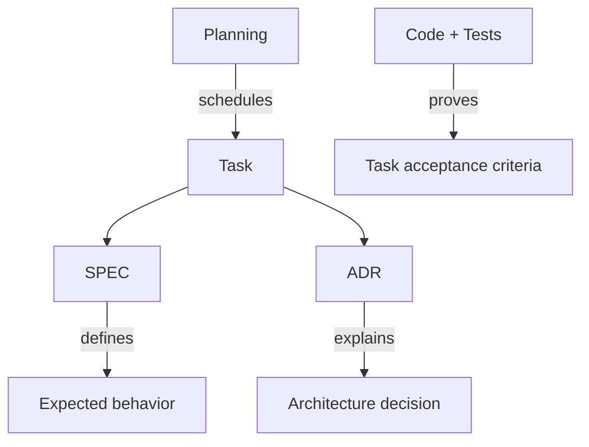

# IncidentLens — nguồn chuẩn cho triển khai RAV-18

Bộ tài liệu được triển khai theo thiết kế đã thống nhất, tham khảo cách tổ chức [workshop-demo-coworking](https://github.com/dzungtri/workshop-demo-coworking). Nội dung nghiệp vụ và đường dẫn code được đối chiếu với checkout này ngày 2026-10-03, commit `1387662c3a79cbc43d340377ee78218669a51dd9`.

| Nguồn | Trách nhiệm | Bắt đầu đọc |
| --- | --- | --- |
| SPEC | Hành vi phải đạt | [specs](specs/README.md) |
| ADR | Quyết định và đánh đổi kiến trúc | [adrs](adrs/README.md) |
| Planning | Thứ tự, trạng thái, sprint | [backlog](planning/backlog.md) |
| Task | Phạm vi, dependency, acceptance, kiểm tra | [tasks](tasks/README.md) |
| Docs | Hướng dẫn phát triển/vận hành | [architecture](docs/architecture.md) |
| Code + tests | Bằng chứng hoàn thành | `../backend`, `../api`, `../frontend`, `../tests` |

Đọc [AGENTS.md](AGENTS.md), chọn task, đọc SPEC/ADR được liên kết, thực hiện và cập nhật bằng chứng. Code hiện có giữ ở thư mục gốc; `tools/` chứa governance và tài liệu. Bộ này mô tả đích MVP và kế hoạch thực hiện; việc tạo tài liệu không có nghĩa các capability TODO đã được triển khai.

Hai cấu hình `external_api` và `self_hosted` được giữ để so sánh. Chưa quyết định nhà cung cấp, mua GPU hoặc production storage. External reference là thứ tự làm baseline, không phải quyết định dùng API trong production.

## Quy ước nhất quán

- Requirement: `REQ-<domain>-NNN`; NFR: `NFR-<domain>-NNN`.
- ADR: `ADR-NNN`; task chỉ dùng `RAV-NNN`, không dùng song song AI/BE ID.
- Sprint 01 foundation; 02 detection; 03 VLM; 04 review; 05 evaluation/hardening.
- Backlog: `DONE` chỉ khi có bằng chứng đúng phạm vi; `PARTIAL`, `TODO`, `BLOCKED` theo [planning](planning/README.md).
- Lifecycle incident, job và report độc lập; sơ đồ tổng quát không thay enum API v1.1.
- Giá/model trong hội thoại là gợi ý; đo và xác minh khi thực hiện benchmark, không dùng làm dự toán đã chốt.

## Reference và hướng dẫn đọc

[Implementation audit](docs/implementation-audit.md) đối chiếu 20 task với code/test hiện tại. [Repository roles](docs/repository-roles.md) dẫn tới Backend/API/Frontend docs riêng.

[Mapping repo mẫu](docs/reference-mapping.md) giải thích lifecycle và các điều chỉnh cho checkout này. [Hai phương án inference](docs/inference-options.md) giữ lựa chọn chi phí/chính sách mở. [Baseline evidence](docs/baseline-evidence.md) phân biệt code đã test với capability V2 còn thiếu.
