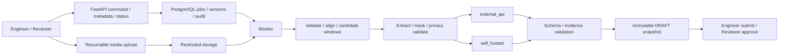

# Architecture

## Current implementation

Next.js ở `frontend/`; FastAPI ở `api/`; domain/services/models/worker ở `backend/`. PostgreSQL qua SQLAlchemy/Alembic. Queue là bảng Job với SKIP LOCKED, lease 120 giây, max 3 attempts và heartbeat, không có Redis/Celery trong compose. LocalStorage giữ upload/evidence; FFmpeg/ffprobe xử lý media. OpenAIVLMAdapter gửi image blocks cho pass1/pass2; clip hiện chỉ evidence, chưa gửi video cho model. Pass1 dùng đúng 5 frame cho mọi duration.

`docker-compose.yml` có postgres/backend/worker; frontend chạy riêng. LangGraph hiện có scaffolding, không coi như orchestrator toàn pipeline đã tích hợp. Review edit có ReportVersion; transitions đổi row + audit nhưng không tăng snapshot version. Production media/review bị 403 bởi require_demo_access, chưa auth thật.

## Target

V2 nhiều candidate/report trên một recording. Self-host raw input chỉ theo internal policy; frontend vẫn MASKED. Worker resource/call budget, checkpoint/partial/resume; job stage và report state tách riêng. API/worker không load toàn video vào RAM. Storage implementation chờ ADR-006; inference production chờ kết quả benchmark và quyết định owner. [ADRs](../adrs/README.md), [tasks](../tasks/README.md) chứa quyết định và plan chi tiết.

Role-specific implementation: [Backend](../../backend/docs/implementation.md), [API](../../api/docs/routes.md), [Frontend](../../frontend/docs/implementation.md). Kiến trúc đích trong tools không thay thế trạng thái audit code hiện tại.
